# NGHIÊN CỨU MÔ HÌNH LAI GNN–GCL–MULTIMODAL RAG CHO NỀN TẢNG MẠNG XÃ HỘI THƯƠNG MẠI ĐỒ ĐIỆN TỬ

## Tóm tắt

Tư vấn mua sắm thiết bị điện tử đòi hỏi kết hợp hiểu nhu cầu bằng ngôn ngữ tự nhiên, đối chiếu thông số kỹ thuật, khai thác hình ảnh và nhận diện sở thích người dùng. Các thành phần này có nguồn giám sát và tiêu chí đánh giá khác nhau: độ tương đồng ngữ nghĩa không bảo đảm đáp ứng ràng buộc phần cứng; độ chính xác gợi ý không đồng nhất với tính trung thực của câu trả lời; ảnh sản phẩm tiêu chuẩn không thể xác nhận tình trạng của một thiết bị đã qua sử dụng. Nghiên cứu xây dựng khung lai gồm biểu diễn tri thức đa phương thức, truy hồi lai có kiểm soát ràng buộc, hệ gợi ý trên đồ thị dị thể và cơ chế phản hồi tương hỗ giữa truy hồi tăng cường sinh với gợi ý cá nhân hóa.

Văn bản được biểu diễn bằng encoder MiniLM đa ngôn ngữ, hình ảnh được mã hóa bằng CLIP ViT-B/32. Thông số được tổ chức theo cấu trúc nhóm–thuộc tính–giá trị và liên kết với đồ thị người dùng–sản phẩm–nội dung. Học tương phản đồ thị được khảo sát nhằm tăng độ bền khi thiếu tương tác. Cơ chế kết hợp được thực nghiệm ở hai cấp: tái xếp hạng khi suy luận và tối ưu đồng thời các hàm mất mát trong huấn luyện. Một biến thể bổ sung giữ điểm tương đồng ngữ nghĩa cố định và học thành phần hiệu chỉnh có biên độ giới hạn.

Thực nghiệm chính sử dụng tập con Electronics với 4.781 sản phẩm, 2.380 người dùng và 10.080 tương tác huấn luyện, kết hợp dữ liệu Amazon Reviews 2023 với nguồn hội thoại mô phỏng công khai. Trên 76 truy vấn kiểm tra thuộc 38 người dùng, truy hồi lai đạt Recall@10 bằng 0,355263 và NDCG@10 bằng 0,265861. Chênh lệch NDCG@10 so với BM25 có khoảng bootstrap 95% chứa 0, nên chưa xác nhận ưu thế ổn định. Khi lượng tương tác huấn luyện thực tế giảm còn 31,35%, bổ sung GCL làm tăng HR@10 khoảng 0,006133 so với cùng đồ thị không GCL; tác động không duy trì đồng nhất ở các mức giữ dữ liệu cao hơn. Các biến thể học kết hợp chưa vượt đối chứng truy hồi văn bản giữ nguyên trọng số. Một bộ gợi ý thứ hai, Amazon Reviews 2023 Baby_Products (8.203 người dùng, 3.799 sản phẩm), lặp lại các xu hướng này: thêm ảnh không tạo khác biệt có ý nghĩa, còn GCL và VBPR đạt thấp hơn đối chứng. Bộ thứ ba, MIND-small (tin tức, chỉ văn bản, 6.000 người dùng, 20.392 tin), chỉ chạy được ba phương pháp dùng văn bản: cả ba có HR@10 (0,0196–0,0229) cao hơn Popularity (0,0143) nhưng khác biệt giữa chúng có khoảng bootstrap chứa 0 hoặc sát 0. Thử nghiệm sinh câu trả lời có viện dẫn ban đầu hoàn thành 9 trong 12 đầu ra dự kiến; đợt mở rộng 104 câu (OpenAI gpt-4.1-mini, sinh và chấm cùng nhà cung cấp) cho faithfulness thô 0,852 ở nhánh chữ và 0,945 ở nhánh chữ–ảnh, nhưng toàn bộ 28 nhận định bị gắn không được hỗ trợ là câu từ chối đúng, nên chênh lệch này không chứng minh lợi ích của ảnh; tác động quan sát được của ảnh là tăng độ bao phủ kiểm chứng của judge từ 0,58 lên 0,81. Độ liên quan của câu trả lời theo phương pháp câu hỏi ngược đạt 0,617966 ở nhánh chữ và 0,612966 ở nhánh chữ–ảnh, chênh lệch ghép cặp có khoảng bootstrap chứa 0. Một rà soát bổ sung 30 câu do mô hình AI lớn (Claude) thực hiện tìm thấy lỗi ở 9 câu mà judge không gắn cờ, nên judge tự động đơn lẻ không đủ tin cậy để suy ra tỷ lệ ảo giác. Nghiên cứu cài đặt và đánh giá hai phương thức chữ và ảnh; video và âm thanh nằm ngoài phạm vi thực nghiệm. Các kết quả được phân tích cùng giới hạn về dữ liệu mô phỏng, nhãn liên quan không đầy đủ, đánh giá cùng nhà cung cấp mô hình và tính đại diện của mẫu thực nghiệm.

**Từ khóa:** gợi ý hội thoại đa phương thức; truy hồi tăng cường sinh; đồ thị dị thể; học tương phản đồ thị; truy hồi lai; kiểm soát ràng buộc; cá nhân hóa.

## Danh mục chữ viết tắt

**Bảng danh mục. Danh mục chữ viết tắt và ý nghĩa sử dụng.**

| Ký hiệu | Thuật ngữ | Ý nghĩa sử dụng |
|---|---|---|
| C-MMRec | Conversational Multimodal Recommendation | Gợi ý hội thoại sử dụng dữ liệu đa phương thức |
| IR | Information Retrieval | Truy hồi thông tin |
| RAG | Retrieval-Augmented Generation | Sinh câu trả lời có bổ sung bằng chứng truy hồi |
| MRAG | Multimodal RAG | RAG sử dụng bằng chứng đa phương thức |
| RecSys | Recommender System | Hệ thống gợi ý |
| GNN | Graph Neural Network | Mạng nơ-ron đồ thị |
| GCL | Graph Contrastive Learning | Học tương phản đồ thị |
| BPR | Bayesian Personalized Ranking | Mục tiêu học thứ hạng từ phản hồi ngầm định |
| RRF | Reciprocal Rank Fusion | Hợp nhất thứ hạng nghịch đảo |
| CE | Cross-Entropy | Hàm mất mát entropy chéo |
| KL | Kullback–Leibler Divergence | Độ phân kỳ Kullback–Leibler |
| JS | Jensen–Shannon Divergence | Độ phân kỳ Jensen–Shannon |
| HR | Hit Ratio | Tỷ lệ tìm lại mục tiêu trong danh sách đầu |
| NDCG | Normalized Discounted Cumulative Gain | Độ lợi tích lũy có chiết khấu chuẩn hóa |
| MRR | Mean Reciprocal Rank | Trung bình nghịch đảo thứ hạng mục tiêu đầu tiên |
| RSS | Resident Set Size | Bộ nhớ vật lý đang được tiến trình sử dụng |

# CHƯƠNG 1. XÁC ĐỊNH BÀI TOÁN VÀ YÊU CẦU CỦA NỀN TẢNG MẠNG XÃ HỘI THƯƠNG MẠI ĐỒ ĐIỆN TỬ THÔNG MINH

## 1.1. Bối cảnh và nhu cầu thực tế của mạng xã hội thương mại đồ điện tử

Nền tảng mạng xã hội thương mại kết hợp hoạt động khám phá nội dung, trao đổi trải nghiệm và giao dịch sản phẩm. Đối với thiết bị điện tử, quá trình lựa chọn thường liên quan đồng thời đến đặc điểm phần cứng, mục đích sử dụng và thông tin trải nghiệm. Một yêu cầu như tìm điện thoại phục vụ chơi game có thể đi kèm điều kiện dung lượng lưu trữ, hãng sản xuất hoặc pin, trong khi mức độ phù hợp còn phụ thuộc nhu cầu hiện tại của người hỏi. Việc chỉ so khớp từ khóa khó biểu diễn đầy đủ các quan hệ này.

Dữ liệu trong môi trường thương mại có hai lớp thông tin quan trọng. Lớp thông số kỹ thuật, gọi là *hard specs*, chứa các trường có cấu trúc như bộ nhớ, RAM, CPU, dung lượng pin hoặc khả năng kết nối. Lớp trải nghiệm, gọi là *soft experiences*, gồm đánh giá, nhận xét, mô tả sử dụng và nội dung hội thoại. Hai lớp có vai trò bổ sung nhưng không thay thế nhau. Nhận xét chủ quan về tốc độ không xác lập một cấu hình phần cứng cụ thể; thông số trong catalog cũng có thể chứa lỗi nhập liệu hoặc thiếu đơn vị.

Hình ảnh cung cấp thông tin về ngoại hình, màu sắc và cách bố trí các bộ phận nhìn thấy. Tuy nhiên, phạm vi suy luận phụ thuộc loại ảnh. Ảnh catalog thường mô tả thiết kế tiêu chuẩn của dòng sản phẩm, còn ảnh bài đăng có thể mô tả một thiết bị cụ thể. Việc suy từ ảnh catalog sang tình trạng trầy xước, sức khỏe pin hoặc lịch sử sửa chữa là không có cơ sở. Vì vậy, sử dụng ảnh trong tư vấn cần đi kèm nhận diện nguồn và giới hạn bằng chứng.

Một yêu cầu khác là cá nhân hóa. Lịch sử tương tác có thể phản ánh mối quan tâm tương đối ổn định, nhưng không quyết định mọi truy vấn về sau. Người thường quan tâm điện thoại hiệu năng cao vẫn có thể tìm một thiết bị đơn giản cho người thân. Hệ thống cần phân biệt sở thích dài hạn với ý định của phiên hiện tại, đồng thời cho phép yêu cầu tường minh ghi đè tín hiệu lịch sử khi chúng mâu thuẫn.

Từ các đặc điểm trên, nền tảng cần đáp ứng ba yêu cầu: truy hồi sản phẩm và bằng chứng liên quan; xếp hạng phù hợp với người dùng và ngữ cảnh; sinh phản hồi có thể đối chiếu với nguồn. Chất lượng hệ thống được xem xét ở từng thành phần và ở cơ chế kết nối giữa các thành phần, thay vì chỉ đánh giá mức độ lưu loát của câu trả lời.

## 1.2. Bài toán tư vấn hội thoại đa phương thức — Conversational Multimodal Recommendation

### 1.2.1. Ký hiệu và đầu vào

Gọi $\mathcal U$ là tập người dùng và $\mathcal I$ là tập sản phẩm. Với sản phẩm $i$, $M_i$ biểu diễn metadata văn bản, $V_i$ biểu diễn ảnh, $S_i$ là các thông số có cấu trúc và $R_i$ là nội dung trải nghiệm có nguồn. Tại lượt hội thoại $t$, người dùng $u$ đưa ra truy vấn $q_t$. Lịch sử hội thoại trước lượt hiện tại được ký hiệu $H_t$; các tương tác có sẵn tại thời điểm dự đoán được ký hiệu $I_u$.

$$
X_t=\left(u,q_t,H_t,I_u,\{M_i,V_i,S_i,R_i\}_{i\in\mathcal I}\right).
\tag{1.1}
$$

Trong thực nghiệm offline, tập tương tác được chia thành huấn luyện, xác thực và kiểm tra. Lịch sử cung cấp cho mô hình chỉ gồm thông tin được phép quan sát theo giao thức. Sản phẩm mục tiêu, đánh giá tương lai và mô tả mục tiêu của bộ mô phỏng thuộc phía đánh giá, không thuộc đầu vào của tác tử.

**Bảng 1.1. Ký hiệu chính của bài toán.**

| Ký hiệu | Ý nghĩa |
|---|---|
| $q_t$, $H_t$ | Truy vấn hiện tại và lịch sử hội thoại trước đó |
| $I_u^{train}$ | Tập sản phẩm người dùng đã tương tác trong phần huấn luyện |
| $\mathbf t_i$, $\mathbf v_i$ | Vector văn bản và vector ảnh của sản phẩm |
| $m_i$ | Mặt nạ xác định sản phẩm có ảnh hợp lệ |
| $\mathcal G=(\mathcal V,\mathcal E)$ | Đồ thị dị thể của hệ thống |
| $C_t$, $P_t$ | Ràng buộc tường minh và nhu cầu mềm tại lượt hiện tại |
| $E_t$, $F_t$, $A_t$ | Tập bằng chứng, danh sách gợi ý và câu trả lời |
| $\theta$ | Các tham số được học trong nhánh gợi ý và ánh xạ truy vấn |

### 1.2.2. Quá trình xử lý

Hệ thống thực hiện bốn nhóm thao tác. Thứ nhất, metadata, ảnh và thông số được chuẩn hóa thành biểu diễn và cấu trúc đồ thị. Thứ hai, truy vấn được phân tích thành ý định, ràng buộc và nội dung viết lại có ngữ cảnh. Thứ ba, các bộ truy hồi lexical và dense tạo ứng viên, sau đó kiểm tra điều kiện kỹ thuật. Thứ tư, nhánh gợi ý và nhánh truy hồi trao đổi tín hiệu để tái xếp hạng; bộ sinh nhận bằng chứng cuối cùng và tạo phản hồi.

Toàn bộ quá trình được ký hiệu:

$$
(F_t,E_t,A_t,U_t)=\Phi(X_t;\theta),
\tag{1.2}
$$

trong đó $U_t$ chứa các trường chưa xác minh, lý do từ chối hoặc giới hạn bằng chứng. Việc trả về trạng thái chưa xác minh được xem là một dạng đầu ra hợp lệ khi nguồn thiếu dữ kiện.

### 1.2.3. Đầu ra và mục tiêu đánh giá

Danh sách $F_t$ phục vụ đề xuất sản phẩm hoặc nội dung; $E_t$ là tập bằng chứng hỗ trợ trả lời; $A_t$ là phản hồi ngôn ngữ tự nhiên có viện dẫn. Mục tiêu nghiên cứu gồm tìm lại mục tiêu liên quan, nâng thứ hạng gợi ý và bảo đảm nhận định được bằng chứng hỗ trợ. Ba mục tiêu được đo riêng vì cải thiện thứ hạng không bảo đảm cải thiện tính trung thực của câu trả lời.

Các tham số học được gồm embedding định danh, embedding thông số, phép chiếu đặc trưng và lớp ánh xạ truy vấn. Encoder văn bản, encoder ảnh và mô hình ngôn ngữ không được huấn luyện lại trong các thí nghiệm này. Sự phân chia cho phép đánh giá tác động của đồ thị, GCL và học kết hợp mà không đồng thời thay đổi nền biểu diễn đầu vào.

## 1.3. Khảo sát các hướng tiếp cận liên quan

### 1.3.1. Multimodal Information Retrieval

Truy hồi thông tin đa phương thức tìm tài liệu hoặc sản phẩm phù hợp với truy vấn thông qua nhiều loại dữ liệu. Kiến trúc phổ biến gồm bộ mã hóa truy vấn, bộ mã hóa từng loại tài liệu, chỉ mục và cơ chế tính độ liên quan. Phương pháp lexical dựa vào sự xuất hiện của từ; phương pháp dense sử dụng biểu diễn liên tục để nhận diện các biểu đạt gần nghĩa. BM25 là một đại diện lexical có cơ chế điều chỉnh tần suất từ theo chiều dài tài liệu [R17].

Sentence-BERT xây dựng embedding câu từ mô hình Transformer bằng cấu trúc huấn luyện phù hợp cho so khớp ngữ nghĩa [R1]. Đặc điểm này cho phép mã hóa trước nội dung và truy vấn rồi so sánh bằng cosine, thay vì đưa từng cặp văn bản qua một mô hình so khớp riêng. Trong miền sản phẩm, biểu diễn câu hỗ trợ các cách diễn đạt khác nhau nhưng vẫn có nguy cơ coi hai cấu hình gần nghĩa là tương đương.

CLIP học sự tương ứng giữa ảnh và văn bản [R2]. Khi áp dụng truy hồi, truy vấn được mã hóa bằng nhánh văn bản CLIP và so với embedding ảnh trong cùng không gian. Cơ chế này phù hợp với đặc điểm thị giác tổng quát; việc nhận diện chính xác RAM, sức khỏe pin hoặc thuộc tính không nhìn thấy vẫn cần nguồn cấu trúc riêng.

**Phạm vi phương thức của nghiên cứu.** Truy hồi đa phương thức nói chung bao gồm cả video và âm thanh; khảo sát [R10] phân loại dữ liệu theo các cặp ảnh–văn bản, video–văn bản và âm thanh–văn bản. Nghiên cứu này cài đặt và đánh giá **chữ và ảnh**, không cài đặt video hay âm thanh. Lý do là điều kiện dữ liệu: các catalog Electronics và điện thoại sử dụng ở đây không có trường video, còn trường `videos` trong metadata Amazon Reviews 2023 chỉ lưu tiêu đề và đường dẫn trang xem video (khoảng 78% sản phẩm trong tập con Baby_Products có mục này), không phải tệp video; chúng tôi không biết một bộ dữ liệu công khai nào có video đánh giá hoặc kiểm tra thiết bị điện tử kèm nhãn truy hồi hay gợi ý. Về thiết kế, video và âm thanh có thể được đưa vào cùng kiến trúc bằng cách lấy khung hình đại diện mã hóa qua nhánh ảnh và chuyển lời nói thành văn bản đi vào nhánh chữ; hướng này chưa được cài đặt và chưa có kết quả thực nghiệm nào hỗ trợ cho nó.

ColPali khai thác biểu diễn nhiều vector của ảnh trang tài liệu và late interaction [R7]. Vì vậy, không thể xem mọi phương pháp truy hồi đa phương thức là tìm kiếm một vector duy nhất. Các biểu diễn nhiều vector có thể bảo toàn chi tiết bố cục tốt hơn, nhưng kéo theo yêu cầu chỉ mục và tính điểm khác với catalog sản phẩm.

MIDR đề xuất chuyển một phần xử lý đa phương thức sang thời điểm lập chỉ mục: mô hình đa phương thức tạo các trường văn bản bổ sung, sau đó truy hồi bằng BM25F và tùy chọn kết hợp dense [R16]. Đây là hướng giảm nhu cầu suy luận thị giác ở thời điểm phục vụ; chất lượng dữ liệu bổ sung phụ thuộc độ chính xác của bước diễn giải. Nghiên cứu được dẫn theo bản tiền ấn phẩm năm 2026.

**Bảng 1.2. Các hướng biểu diễn và truy hồi liên quan.**

| Hướng tiếp cận | Kiến trúc và kỹ thuật | Ưu điểm phù hợp với bài toán | Hạn chế cần xét |
|---|---|---|---|
| BM25 [R17] | Chỉ mục đảo; tần suất từ và chuẩn hóa chiều dài | Giữ được tên hãng, model và từ khóa kỹ thuật | Khó nối các diễn đạt khác từ vựng |
| Sentence-BERT [R1] | Encoder câu; cosine giữa truy vấn và tài liệu | Truy hồi các mô tả gần nghĩa | Không trực tiếp kiểm tra điều kiện số học |
| CLIP [R2] | Hai encoder ảnh–văn bản cùng không gian | Truy vấn văn bản có thể tìm ảnh liên quan | Đặc tính không nhìn thấy không được xác minh |
| ColPali [R7] | Nhiều vector ảnh trang; late interaction | Bảo toàn chi tiết thị giác và bố cục | Khác miền catalog; chỉ mục phức tạp hơn single-vector |
| MIDR [R16] | Làm giàu tại thời điểm lập chỉ mục; BM25F/dense | Giảm suy luận đa phương thức khi truy vấn | Bước tạo nội dung bổ sung có thể đưa lỗi vào chỉ mục |

Thách thức đối với nghiên cứu này là kết hợp ưu điểm từ vựng và ngữ nghĩa mà vẫn giữ khả năng kiểm tra thông số. RRF [R18] được sử dụng để hợp nhất thứ hạng, tránh cộng trực tiếp các điểm không cùng thang đo. Cơ chế kiểm ràng buộc được đặt sau bước tạo ứng viên để xử lý các điều kiện tường minh.

### 1.3.2. Multimodal Retrieval-Augmented Generation

RAG đưa tài liệu ngoài vào ngữ cảnh sinh nhằm gắn câu trả lời với nguồn. Trong MRAG, bằng chứng có thể gồm văn bản, ảnh hoặc các phương thức khác. Khung tổng quan của Mei và cộng sự phân tách các thành phần truy hồi, tổ chức ngữ cảnh, sinh và đánh giá [R10]. Sự phân tách này phù hợp với yêu cầu đo riêng chất lượng lấy bằng chứng và chất lượng sử dụng bằng chứng.

VisRAG xây dựng luồng truy hồi và sinh dựa trên biểu diễn thị giác của tài liệu [R8]. M3DocRAG nghiên cứu truy hồi đa phương thức cho nhiều trang và nhiều tài liệu [R9]. Hai hướng cho thấy chuyển toàn bộ tài liệu thành văn bản thuần có thể làm mất thông tin thị giác, song kết quả trên nhiệm vụ tài liệu không tự chuyển thành hiệu quả tư vấn sản phẩm.

VISOR kết hợp truy hồi lặp với tổ chức không gian bằng chứng và suy luận nhiều bước; phương pháp sử dụng học tăng cường để điều chỉnh hành động [R12]. Đây là hướng liên quan đến tác tử truy hồi tương tác, khác với quy trình truy hồi một lần và sinh một câu trả lời trong pilot của nghiên cứu hiện tại.

**Bảng 1.3. Các công trình MRAG tiêu biểu và gần đây.**

| Công trình | Trọng tâm kiến trúc | Quan hệ với nghiên cứu hiện tại | Phạm vi chưa được tái lập |
|---|---|---|---|
| Tổng quan MRAG [R10] | Phân loại retrieval, generation, dữ liệu và đánh giá | Cơ sở phân tách các thành phần và tiêu chí đo | Không phải một baseline có điểm duy nhất |
| VisRAG [R8] | Biểu diễn thị giác cho truy hồi và VLM sinh | Bảo toàn bằng chứng ảnh thay vì chỉ mô tả chữ | Benchmark tài liệu của tác giả |
| M3DocRAG [R9] | Truy hồi đa phương thức nhiều trang, nhiều tài liệu | Tổ chức evidence khi thông tin phân tán | Tác vụ đa tài liệu đầy đủ |
| VISOR [R12] | Truy hồi–suy luận lặp và điều chỉnh hành động | Định hướng cho hội thoại và truy hồi nhiều bước | Huấn luyện tăng cường và đánh giá tác tử của tác giả |

Các phương pháp được khảo sát có đối tượng dữ liệu, độ dài ngữ cảnh và ngân sách tính toán khác nhau. Do đó, bảng khảo sát phản ánh các hướng kỹ thuật, không tạo một bảng xếp hạng SOTA chung cho thương mại điện tử.

Ba giới hạn chính của MRAG liên quan trực tiếp đến đề tài. Một là truy hồi sai có thể cung cấp bằng chứng không phù hợp. Hai là bộ sinh có thể suy rộng vượt nguồn dù tài liệu được truy hồi đúng. Ba là citation hợp lệ về mặt định dạng vẫn có thể gắn với một đoạn không hỗ trợ nhận định. Đánh giá vì vậy cần phân biệt mức liên quan của câu trả lời, tính được nguồn hỗ trợ và độ đúng của chính nguồn ngoài thực tế.

### 1.3.3. Multimodal Recommender Systems

Hệ gợi ý học mối quan hệ giữa người dùng và sản phẩm từ các tương tác đã quan sát. Khi bổ sung ảnh và văn bản, mô hình có thêm tín hiệu về sản phẩm có ít tương tác. Tuy nhiên, mức hữu ích của mỗi phương thức phụ thuộc miền và cách biểu diễn nội dung.

LightGCN đơn giản hóa lan truyền trên đồ thị tương tác, loại bỏ phép biến đổi đặc trưng và hàm kích hoạt ở mỗi lớp, rồi tổng hợp biểu diễn qua các tầng [R3]. VBPR bổ sung đặc trưng thị giác vào phân rã nhân tố để học các chiều ngoại hình liên quan đến sở thích [R4]. SGL khai thác các góc nhìn tăng cường của đồ thị để tạo tín hiệu tự giám sát [R5]. BM3 dùng dropout trong không gian biểu diễn và các mục tiêu bootstrap, tránh lấy mẫu âm trong mục tiêu chính [R6].

GRE-MC khảo sát hoàn thiện phương thức bị thiếu thông qua truy hồi đồ thị con có liên quan và kết hợp bằng graph transformer [R11]. Hướng này khác việc đơn thuần gán vector 0 và mặt nạ cho ảnh thiếu. Nghiên cứu hiện tại áp dụng mặt nạ, chưa tái tạo nội dung ảnh hoặc triển khai phương pháp hoàn thiện phương thức.

**Bảng 1.4. Các hướng gợi ý được khảo sát.**

| Hướng/công trình | Tín hiệu chính | Cơ chế học | Hạn chế đối với bài toán |
|---|---|---|---|
| Popularity | Số tương tác huấn luyện của sản phẩm | Xếp hạng không cá nhân hóa | Thiên về sản phẩm phổ biến |
| LightGCN [R3] | Cạnh người dùng–sản phẩm | Lan truyền tuyến tính; học thứ hạng | Ít tín hiệu cho sản phẩm chưa có tương tác |
| VBPR [R4] | Tương tác và ảnh | Nhân tố cộng tác kết hợp thành phần thị giác | Ảnh không luôn phản ánh yếu tố quyết định mua |
| SGL [R5] | Tương tác và các graph view | Tự giám sát giữa các góc nhìn | Chất lượng tăng cường phụ thuộc cấu trúc dữ liệu |
| BM3 [R6] | Tương tác, văn bản, ảnh | Bootstrap và stop-gradient | Kết quả nhạy với giao thức và đặc trưng |
| GRE-MC [R11] | Đồ thị và phương thức thiếu | Truy hồi đồ thị con, graph transformer | Tăng độ phức tạp; cần đánh giá riêng bài toán thiếu phương thức |

Những công trình này cung cấp cơ sở lựa chọn baseline và thiết kế triệt tiêu thành phần. Các mô hình được triển khai trong dự án là bản thích nghi trên cùng đặc trưng và dữ liệu đã cố định; kết quả không được xem là tái lập toàn bộ thiết lập trong công bố gốc.

## 1.4. Hạn chế của các phương pháp hiện hành và thách thức

### 1.4.1. Khoảng cách giữa tương đồng ngữ nghĩa và thỏa mãn điều kiện

Hai sản phẩm có mô tả tương tự có thể khác nhau ở thuộc tính quan trọng như bộ nhớ hoặc khả năng kết nối. Nếu chỉ dùng vector ngữ nghĩa, mục gần nhất chưa chắc thỏa yêu cầu tường minh. Kiểm ràng buộc theo trường dữ liệu là một thành phần cần thiết để bổ sung cho truy hồi gần nghĩa.

### 1.4.2. Khác biệt về mức tin cậy giữa các nguồn

Thông số có cấu trúc, ý kiến trải nghiệm và ảnh có mức xác minh khác nhau. Nguồn catalog có thể chứa số liệu nghi vấn; đánh giá cá nhân mang tính chủ quan; ảnh tiêu chuẩn không phản ánh lịch sử sử dụng của thiết bị. Hệ thống cần biểu diễn trạng thái chưa biết và duy trì liên kết giữa nhận định với nguồn gốc dữ liệu.

### 1.4.3. Xung đột giữa ý định tức thời và sở thích dài hạn

Kết hợp lịch sử với truy vấn có thể nâng tính cá nhân hóa nhưng cũng có thể làm trôi truy hồi khỏi nhu cầu hiện tại. Cơ chế hai chiều cần được kiểm định bằng các đối chứng bật/tắt từng hướng. Việc bổ sung kết nối giữa hai mô-đun không tự tạo ra hiệu quả hiệp đồng.

### 1.4.4. Độ thưa và giới hạn của tín hiệu giám sát

Đánh giá tích cực là một dấu hiệu quan tâm, không tương đương toàn bộ lịch sử nhấp, xem hoặc mua. Sản phẩm chưa có tương tác huấn luyện có thể không được gợi ý dù metadata và ảnh đã có. Học tương phản có khả năng bổ sung tín hiệu tự giám sát, nhưng lợi ích phải được kiểm tra theo mức thiếu dữ liệu và không đồng nhất với khả năng khử nhiễu xã hội thực tế.

### 1.4.5. Rủi ro đánh giá vòng tròn và rò rỉ dữ liệu

Nhãn liên quan được suy từ metadata có thể cùng dựa vào quy tắc được sử dụng trong bộ lọc phục vụ. Khi đó, điểm cao chủ yếu phản ánh tính nhất quán với nguồn. Hội thoại mô phỏng còn có nguy cơ đưa mục tiêu tương lai vào đầu vào nếu sử dụng persona, target review hoặc các lượt sau không đúng thời điểm dự đoán. Các rủi ro này được kiểm soát bằng phân chia dữ liệu, giới hạn trường đầu vào và đối chiếu manifest.

## 1.5. Mục tiêu, phạm vi và giải pháp đề xuất của đề tài

### 1.5.1. Mục tiêu nghiên cứu

Nghiên cứu xây dựng khung lai GNN–GCL–Multimodal RAG có khả năng biểu diễn sản phẩm bằng chữ, ảnh và thông số; truy hồi theo nhu cầu hội thoại; học gợi ý từ tương tác; và trao đổi tín hiệu giữa hai nhánh. Mục tiêu thực nghiệm là xác định thành phần nào tạo cải thiện, trong điều kiện nào và với giới hạn nào.

Ba câu hỏi nghiên cứu được đặt ra:

1. **RQ1:** Truy hồi kết hợp lexical, ngữ nghĩa văn bản và ảnh có cải thiện khả năng tìm bằng chứng so với từng kênh riêng trong cùng điều kiện dữ liệu hay không?
2. **RQ2:** Đồ thị đa phương thức và GCL ảnh hưởng thế nào đến độ chính xác gợi ý khi lượng tương tác huấn luyện thay đổi?
3. **RQ3:** Cơ chế Co-Guiding và học kết hợp có nâng đồng thời chất lượng truy hồi và gợi ý so với các đối chứng ngắt kết nối hay không?

Tính được nguồn hỗ trợ của câu trả lời là trục đánh giá bổ sung, được đo trên các đầu ra sinh thực tế thay vì suy từ thứ hạng truy hồi.

### 1.5.2. Phạm vi dữ liệu và ứng dụng

Phạm vi ứng dụng thuộc thiết bị điện tử tiêu dùng. Tập Electronics được sử dụng cho thí nghiệm chính; tập điện thoại phục vụ kiểm tra chức năng và khả năng áp dụng theo ngành hàng. VOGUE được sử dụng như một thử nghiệm truy hồi bổ sung ngoài miền trên hội thoại người–người, không thay đổi miền ứng dụng cuối của đề tài.

Dữ liệu quan sát gồm catalog, ảnh sản phẩm, đánh giá và hội thoại mô phỏng công khai. Tập thực nghiệm chưa bao gồm mạng bạn bè hoặc theo dõi quan sát trực tiếp, chưa có tập ảnh thiết bị đã qua sử dụng đủ nhãn để kết luận về hư hỏng. Phương thức thực nghiệm giới hạn ở chữ và ảnh; video và âm thanh nằm ngoài phạm vi thực nghiệm (xem mục 1.3.1).

### 1.5.3. Giải pháp và đóng góp thực nghiệm

Giải pháp đề xuất gồm: tổ chức đồ thị dị thể có phân cấp thông số; phối hợp truy hồi lai với kiểm ràng buộc và nguồn bằng chứng; khảo sát GCL dưới nhiều mức thiếu tương tác; phân tách cơ chế kết hợp lúc suy luận với học đa nhiệm; và phân tích độ tin cậy của đánh giá sinh có ảnh.

Đóng góp thực nghiệm không chỉ bao gồm các mức điểm đạt được, mà còn gồm nhận diện giới hạn của học kết hợp trên dữ liệu hiện có, phân biệt cải thiện phụ thuộc độ thưa với cải thiện phổ quát và cung cấp hiện vật tái lập có kiểm tra nguồn. Mức độ hỗ trợ các giả thuyết được xác định từ kết quả chương 2.

### Tiểu kết chương 1

Chương 1 xác định tư vấn hội thoại đa phương thức là bài toán kết nối truy hồi, gợi ý và sinh có bằng chứng. Khảo sát cho thấy mỗi thành phần giải quyết một khía cạnh riêng và có giới hạn khi áp dụng vào thiết bị điện tử. Các câu hỏi RQ1–RQ3 là cơ sở xây dựng kiến trúc, thiết kế đối chứng và phân tích thực nghiệm ở chương tiếp theo.

# CHƯƠNG 2. ĐỀ XUẤT MÔ HÌNH LAI MULTIMODAL GNN–GCL–MULTIMODAL RAG CHO NỀN TẢNG MẠNG XÃ HỘI THƯƠNG MẠI

## 2.1. Mô hình kiến trúc tổng quát

Kiến trúc gồm bốn khối liên kết: biểu diễn tri thức và chỉ mục đa phương thức; truy hồi lai có hiểu truy vấn; hệ gợi ý trên đồ thị; cơ chế Co-Guiding hai chiều. Bộ sinh sử dụng bằng chứng do nhánh truy hồi lựa chọn sau khi kiểm ràng buộc. Bộ nhớ hội thoại giữ ngữ cảnh phiên, còn lịch sử tương tác là nguồn cho cá nhân hóa.

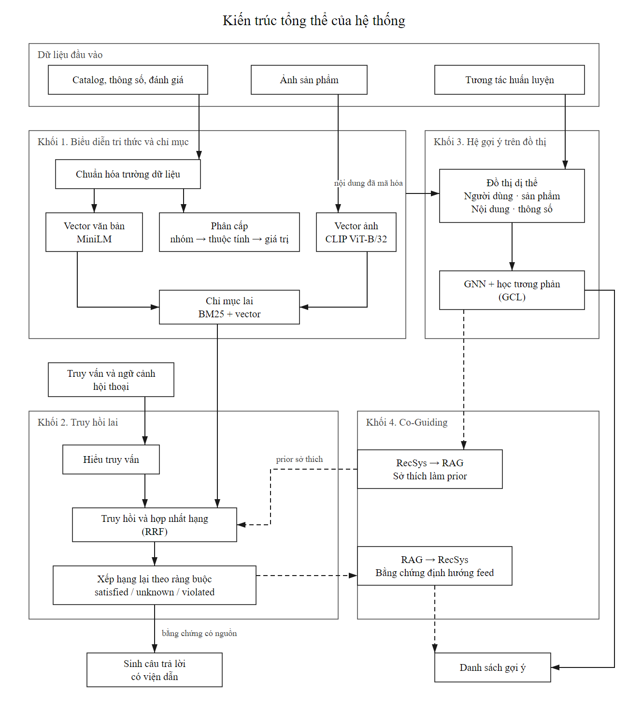

**Hình 2.1. Kiến trúc bốn khối và các luồng dữ liệu của phương pháp.** Nét liền là luồng dữ liệu chính, nét đứt là hai hướng phản hồi của Co-Guiding. Bản vector gốc: [SVG](../../rag/docs/research_figures/architecture/kien_truc_tong_the.svg), [draw.io](../../rag/docs/research_figures/architecture/kien_truc_tong_the.drawio).

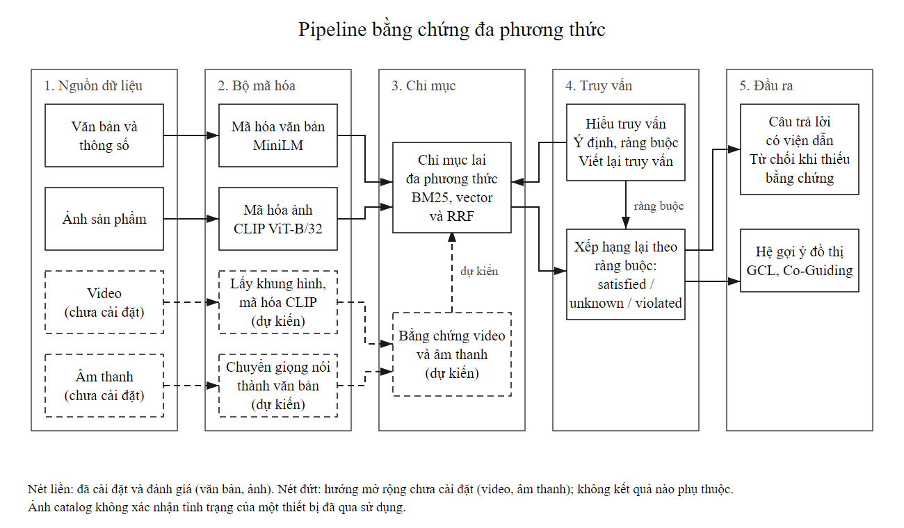

**Hình 2.2. Pipeline bằng chứng đa phương thức.** Nét liền là các thành phần đã cài đặt và đánh giá (chữ, thông số và ảnh); nét đứt là hướng mở rộng đã thiết kế nhưng chưa cài đặt (video qua khung hình đại diện, âm thanh qua nhận dạng lời nói), không kết quả nào trong báo cáo phụ thuộc vào chúng. Bản vector gốc: [SVG](../../rag/docs/research_figures/multimodal_pipeline/multimodal_pipeline.svg), [draw.io](../../rag/docs/research_figures/multimodal_pipeline/multimodal_pipeline.drawio), [mã vẽ](../../rag/src/phone_assistant/reporting/figures/generate_multimodal_pipeline_figure.py).

Quy trình huấn luyện và quy trình suy luận được tách biệt. Trong huấn luyện, chỉ các cạnh và nhãn thuộc tập huấn luyện tác động đến gradient. Trong suy luận, tham số đã học được giữ cố định; truy vấn, ràng buộc và lịch sử hợp lệ làm thay đổi tập ứng viên và thứ hạng mà không kéo theo cập nhật trọng số sau từng lần chat.

Tách biệt này giúp truy vết nguyên nhân thay đổi kết quả. Một cải thiện do tái xếp hạng theo truy vấn không được đồng nhất với cải thiện do học đa nhiệm. Tương tự, chỉ mục vector của sản phẩm có thể được cập nhật khi catalog thay đổi mà không cần huấn luyện lại toàn bộ encoder.

## 2.2. Biểu diễn tri thức và chỉ mục đa phương thức

### 2.2.1. Xử lý văn bản và thông số

#### Chuẩn hóa và lựa chọn trường dữ liệu

Biểu diễn nội dung sử dụng tiêu đề, cửa hàng, đặc trưng, mô tả, danh mục và các trường thông số trong danh sách cho phép. Các trường target review, mô tả do bộ mô phỏng sinh, xếp hạng bán chạy và tín hiệu đích không tham gia xây dựng item feature. Rating và số lượng đánh giá không được ghép vào văn bản embedding của catalog trong thực nghiệm chính.

Văn bản dài được chia thành các đoạn 80 từ, chồng lấn 16 từ. Phép chia giảm mất nội dung do giới hạn chiều dài encoder, nhưng số từ không tương đương số token nên không bảo đảm mọi đoạn đều tránh cắt ngắn. Vector của từng đoạn được chuẩn hóa, trung bình và chuẩn hóa lại. Với $\nu(\mathbf x)=\mathbf x/\max(\|\mathbf x\|_2,\epsilon)$:

$$
\mathbf t_i=\nu\left(\frac{1}{|C_i|}\sum_{c\in C_i}\nu(f_T(c))\right)\in\mathbb R^{384}.
\tag{2.1}
$$

Encoder là `sentence-transformers/paraphrase-multilingual-MiniLM-L12-v2`. Trọng số encoder được giữ nguyên; học downstream diễn ra ở các phép chiếu và thành phần đồ thị. Đặc tính đa ngôn ngữ hỗ trợ truy vấn Việt và metadata Anh, nhưng không thay cho đánh giá chất lượng chuyển ngữ theo miền.

#### Tách trường kỹ thuật và bảo toàn nguồn

RAM, dung lượng lưu trữ và pin được xử lý thành các thuộc tính riêng. Giá trị được chuẩn hóa đơn vị trước khi so sánh; ví dụ TB được đổi về GB trong trường dung lượng. Các trường quan sát được đi kèm tên trường và đoạn giá trị gốc. Khi nhiều trường mâu thuẫn hoặc giá trị có dấu hiệu bất hợp lý, trạng thái xác minh được giữ là chưa biết thay vì điền một giá trị suy đoán.

Nhánh điện thoại cách ly các giá trị RAM nghi vấn theo quy tắc cấu trúc, chẳng hạn RAM lớn bất thường hoặc không phù hợp tương quan với storage. Cách ly là thao tác quản lý độ tin cậy, không phải nhãn sửa lỗi. Cấu hình thật của thiết bị vẫn cần nguồn độc lập để xác nhận.

Ý kiến trải nghiệm được lưu với nguồn đánh giá và tách khỏi thông số. Kho ý kiến điện thoại hiện có 516 đánh giá thuộc tập huấn luyện của 181 sản phẩm. Dữ liệu này hỗ trợ minh họa trải nghiệm, nhưng lợi ích của việc thêm toàn bộ kho ý kiến vào cùng hàm truy hồi chưa được đo trong thí nghiệm chính Electronics.

#### Giới hạn về tình trạng thiết bị

Các mô tả tình trạng như “like-new” hoặc “vỡ màn” chỉ có thể được ghi nhận khi nguồn tường minh hoặc ảnh thiết bị cụ thể cung cấp bằng chứng phù hợp. Bộ catalog hiện tại không cung cấp tập nhãn đủ để xác nhận khả năng nhận diện hư hỏng. Biểu diễn trạng thái thiếu thông tin vì vậy là một phần của mô hình dữ liệu.

### 2.2.2. Trích xuất đặc trưng thị giác ngữ nghĩa cấp độ sâu

Ảnh thực được tải về, kiểm tra khả năng giải mã và mã hóa bằng CLIP ViT-B/32. Đặc trưng đầu vào là pixel ảnh, không phải mô tả ảnh do mô hình ngôn ngữ tạo sẵn. Với $m_i$ là mặt nạ ảnh hợp lệ:

$$
\mathbf v_i=\begin{cases}
\nu(f_V(V_i))\in\mathbb R^{512},&m_i=1,\\
\mathbf 0,&m_i=0.
\end{cases}
\tag{2.2}
$$

Các item thiếu ảnh không tạo nút ảnh tương đương ảnh có thật. Ở baseline sử dụng ảnh, mặt nạ xác định phần tử đủ điều kiện tham gia mục tiêu thị giác. Chỉ số độ sáng hoặc màu chủ đạo trích bằng Pillow được giữ ở baseline visual tags thô; chúng không thay thế embedding CLIP trong mô hình đa phương thức.

Truy hồi ảnh sử dụng encoder văn bản thuộc chính CLIP để mã hóa câu hỏi. Vector MiniLM 384 chiều không được so cosine trực tiếp với vector CLIP 512 chiều. Trong gợi ý đồ thị, các modality được chiếu riêng về cùng chiều ẩn trước khi lan truyền.

### 2.2.3. Xây dựng không gian biểu diễn liên kết

Thông số được tổ chức theo ba tầng: nhóm, thuộc tính và giá trị. Ví dụ một giá trị dung lượng thuộc thuộc tính storage, còn storage thuộc một nhóm thông số bộ nhớ. Một giá trị có ngữ cảnh thuộc tính khác không tự động dùng chung nút chỉ vì biểu diễn số giống nhau.

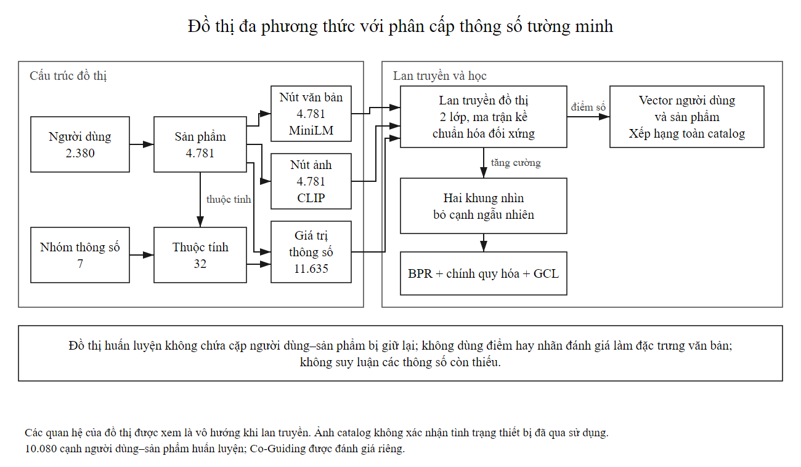

**Hình 2.3. Cấu trúc đồ thị dị thể và phân cấp thông số.** Các cạnh trong hình là quan hệ hai chiều khi xây ma trận kề. Cạnh sản phẩm–thuộc tính rút ngắn đường truyền thông tin trong thiết lập hai lớp.

Với chiều ẩn $d$, văn bản và ảnh được ánh xạ bởi hai ma trận riêng:

$$
\mathbf h_{T_i}^{(0)}=W_T\mathbf t_i,\qquad
\mathbf h_{V_i}^{(0)}=W_V\mathbf v_i,
\quad W_T\in\mathbb R^{d\times384},\ W_V\in\mathbb R^{d\times512}.
\tag{2.3}
$$

Các nút người dùng, sản phẩm và thông số có embedding học được. Thiết kế dị thể nằm ở loại nút, cách khởi tạo và cấu trúc cạnh. Bộ lan truyền hiện dùng chung phép tổng hợp tuyến tính, chưa sử dụng ma trận biến đổi riêng cho từng quan hệ như một relational GNN chuyên biệt.

## 2.3. Khung truy hồi Hybrid Multimodal RAG kết hợp Query Understanding

### 2.3.1. Mô-đun hiểu truy vấn

Planner chuyển câu hỏi thành ý định, ràng buộc cứng, nhu cầu mềm, tham chiếu sản phẩm và câu truy vấn viết lại. Ràng buộc cứng gồm các giá trị được nêu rõ như hãng, dung lượng hoặc loại sản phẩm. Nhu cầu mềm như chơi game, chụp ảnh hoặc pin lâu được giữ như tín hiệu ưu tiên, không đồng nhất với một phép đo hiệu năng cụ thể.

Trạng thái hội thoại được cập nhật bằng phép hợp nhất có xử lý thay thế và đặt lại:

$$
P_t=\operatorname{Plan}(q_t,P_{t-1}),\qquad
\widetilde q_t=\operatorname{Rewrite}(q_t,P_t).
\tag{2.4}
$$

Khi người dùng đổi hãng, điều kiện model gắn với hãng cũ được loại nếu không còn phù hợp. Khi thay dung lượng, giá trị mới thay giá trị cũ thay vì tích lũy hai ràng buộc xung đột. Khi bắt đầu tìm kiếm lại, trạng thái được khởi tạo theo truy vấn mới. Các tham chiếu như “máy đầu tiên” được giải trên danh sách kết quả đã cung cấp ở lượt trước.

Planner hiện sử dụng quy tắc và từ khóa. Do đó, khả năng xử lý tốt các kịch bản đã kiểm tra không đồng nghĩa hiểu mọi diễn đạt tự nhiên. Mức mở rộng từ điện thoại sang toàn Electronics được xem xét thông qua số mục tiêu bị đánh dấu unknown, vi phạm hoặc bị loại do ràng buộc.

### 2.3.2. Cơ chế truy hồi lai

#### Kênh lexical

BM25 sử dụng tần suất từ, tần suất tài liệu và chuẩn hóa chiều dài [R17]. Với $N$ tài liệu trong chỉ mục:

$$
\operatorname{IDF}(w)=\log\left(1+\frac{N-df(w)+0.5}{df(w)+0.5}\right).
\tag{2.5}
$$

$$
s_B(q,d)=\sum_{w\in\operatorname{uniq}(q)}tf(w,q)\operatorname{IDF}(w)
\frac{tf(w,d)(k_1+1)}{tf(w,d)+k_1(1-b+b|d|/\operatorname{avgdl})}.
\tag{2.6}
$$

Thiết lập sử dụng $k_1=1.5$, $b=0.75$. Số lần xuất hiện của từ trong truy vấn được giữ trong trọng số $tf(w,q)$ theo mã thực nghiệm. BM25 tạo điểm phù hợp từ vựng, chưa kiểm chứng tính đúng của thông số trong tài liệu.

#### Kênh ngữ nghĩa và thị giác

Kênh văn bản tính cosine giữa embedding truy vấn MiniLM và $\mathbf t_i$. Kênh thị giác tính cosine giữa embedding truy vấn CLIP và $\mathbf v_i$. Mỗi kênh tạo một danh sách ứng viên có thứ hạng riêng. Sản phẩm không có ảnh hợp lệ không nhận đóng góp từ kênh ảnh.

#### Hợp nhất thứ hạng

RRF [R18] sử dụng thứ hạng thay vì điểm thô:

$$
s_R(q,i)=\sum_{m\in\{B,T,V\}}
\frac{w_m\,\mathbb1[i\in C_m(q)]}{k_0+r_m(q,i)}.
\tag{2.7}
$$

Trong thực nghiệm, $k_0=60$ và $(w_B,w_T,w_V)=(1,1,0.5)$. Thứ hạng bắt đầu từ 1; các item không xuất hiện ở một kênh không nhận điểm từ kênh đó. Các trọng số cố định tránh việc điều chỉnh lặp theo điểm test.

### 2.3.3. Cơ chế xếp hạng lại có kiểm soát ràng buộc thực tế

Mỗi cặp ràng buộc–sản phẩm nhận một trong ba trạng thái: thỏa mãn, vi phạm hoặc chưa xác định. Ví dụ yêu cầu dung lượng 128 GB với sản phẩm không có trường storage hợp lệ dẫn đến trạng thái chưa xác định, thay vì được xem là thỏa mãn mặc định. Một giá trị mâu thuẫn với yêu cầu dẫn đến vi phạm.

Gọi $C_t$ là tập điều kiện cứng. Tập sản phẩm xác minh được theo chế độ lọc nghiêm được ký hiệu:

$$
\mathcal I_{verified}(C_t)=
\{i\in\mathcal I:\operatorname{check}(c,i)=\text{satisfied},\ \forall c\in C_t\}.
\tag{2.8}
$$

Bộ kiểm tra giữ riêng trạng thái tổng hợp, trường bằng chứng và lý do không đủ điều kiện. Khi không có bằng chứng đủ để trả lời theo ràng buộc, hệ có thể từ chối hoặc nêu rõ giới hạn thay vì tạo thông số. Trạng thái satisfied chỉ xác nhận tính nhất quán với nguồn catalog đã sử dụng; nó không xác lập sự thật độc lập về thiết bị.

Đánh giá ảnh hưởng của guard được thực hiện trên cùng truy vấn và vector cache. Điều này giúp tách thay đổi do lọc ràng buộc khỏi thay đổi do viết lại truy vấn hoặc mã hóa lại.

### 2.3.4. Mô-đun sinh câu trả lời có viện dẫn bằng chứng thị giác

Đầu vào bộ sinh gồm câu hỏi, lịch sử liên quan, các đoạn metadata, thông số có trạng thái xác minh và ảnh được lựa chọn. Mỗi ảnh đi kèm mã sản phẩm và mã evidence. Prompt giới hạn câu trả lời vào nguồn được cung cấp và yêu cầu viện dẫn sau nhận định sản phẩm.

Luồng xử lý gồm lập ngữ cảnh, gửi mô hình sinh, lưu câu trả lời gốc, chuẩn hóa trích dẫn số khi ánh xạ rõ và kiểm tra các mã nguồn. Kiểm citation chỉ xác nhận mã được dùng thuộc nguồn cho phép; việc đánh giá hỗ trợ ngữ nghĩa được thực hiện riêng ở cấp nhận định.

Pilot sử dụng Gemini 2.5 Flash, temperature 0, thinking budget 0 và giới hạn 1.024 token đầu ra. Hai arm nhận cùng câu hỏi và văn bản; arm đa phương thức nhận thêm tối đa hai ảnh catalog. Bộ chấm tự động nhận đúng bằng chứng đã cung cấp cho bộ sinh, có giới hạn 3.072 token đầu ra và trả cấu trúc JSON. Các lỗi API và đầu ra thiếu được giữ trong mẫu số độ bao phủ.

Khi mô hình sinh không khả dụng, ứng dụng có chế độ tổng hợp dữ liệu theo mẫu. Kết quả theo mẫu không được gộp với đầu ra Gemini khi đo chất lượng sinh ngôn ngữ.

## 2.4. Mô hình hệ gợi ý đa phương thức

### 2.4.1. Thiết kế đồ thị tương tác không đồng nhất

Tập nút bao gồm người dùng, sản phẩm, văn bản, ảnh, giá trị, thuộc tính và nhóm thông số:

$$
\mathcal V=\mathcal U\cup\mathcal I\cup\mathcal T\cup\mathcal V_{img}
\cup\mathcal S_v\cup\mathcal S_a\cup\mathcal S_g.
\tag{2.9}
$$

Tập cạnh được xây dựng từ tương tác huấn luyện và cấu trúc catalog:

$$
\mathcal E=\mathcal E_{UI}^{train}\cup\mathcal E_{IT}\cup\mathcal E_{IV}
\cup\mathcal E_{IS}\cup\mathcal E_{IA}\cup\mathcal E_{SA}\cup\mathcal E_{AG}.
\tag{2.10}
$$

Chỉ $\mathcal E_{UI}^{train}$ chứa giám sát tương tác. Các cạnh metadata tồn tại cho toàn catalog theo thiết lập transductive. Một mục tiêu giữ lại vẫn có thể có cạnh với người dùng khác thuộc train; điều bị loại là cặp người dùng–mục tiêu giữ lại và các dữ kiện tương lai của chính người dùng theo giao thức.

Các quan hệ đồ thị không được diễn giải thành mạng xã hội quan sát thực khi nguồn không có cạnh bạn bè hoặc theo dõi. Nút text hiện mô tả sản phẩm, chưa phải một tập bài đăng xã hội độc lập đầy đủ.

### 2.4.2. Lan truyền thông điệp đồ thị tích hợp đặc trưng đa phương thức

Gọi $A$ là ma trận kề đối xứng và $D$ là ma trận bậc. Lan truyền tuyến tính theo cấu trúc LightGCN [R3] được thực hiện như sau:

$$
\widehat A=D^{-1/2}AD^{-1/2},\qquad
H^{(\ell+1)}=\widehat A H^{(\ell)},\qquad
\bar H=\frac{1}{L+1}\sum_{\ell=0}^{L}H^{(\ell)}.
\tag{2.11}
$$

Với nút cô lập, bậc được chặn tối thiểu ở 1 trong phép chuẩn hóa để tránh chia cho 0. Điểm gợi ý là tích vô hướng giữa biểu diễn người dùng và sản phẩm:

$$
s(u,i)=\bar{\mathbf h}_u^{\mathsf T}\bar{\mathbf h}_i.
\tag{2.12}
$$

Các mô hình học thứ hạng dùng BPR [R19]. Với bộ ba $(u,i,j)$ gồm tương tác dương huấn luyện và sản phẩm chưa có tương tác huấn luyện của người dùng:

$$
\mathcal L_{BPR}=-\frac{1}{|B|}\sum_{(u,i,j)\in B}
\log\sigma\bigl(s(u,i)-s(u,j)\bigr).
\tag{2.13}
$$

Sản phẩm chưa quan sát là mẫu âm cho mục tiêu học, không phải phản hồi không thích đã được xác nhận. Nhãn tương lai không được sử dụng để lựa chọn mẫu âm.

#### Học tương phản đồ thị

Hai graph view được tạo bằng dropout cạnh. Một cạnh vô hướng bị loại đồng thời ở cả hai chiều, tránh tạo sai khác do hướng cạnh ngoài chủ đích tăng cường. Sau lan truyền, biểu diễn cùng nút ở hai view được xem là cặp dương; các nút khác trong tập lấy mẫu tạo mẫu đối chiếu.

$$
\ell_X^{1\rightarrow2}=-\frac{1}{|B_X|}\sum_{x\in B_X}
\log\frac{\exp\bigl(\nu(\mathbf h_x^1)^{\mathsf T}\nu(\mathbf h_x^2)/\tau\bigr)}
{\sum_{y\in B_X}\exp\bigl(\nu(\mathbf h_x^1)^{\mathsf T}\nu(\mathbf h_y^2)/\tau\bigr)}.
\tag{2.14}
$$

$$
\mathcal L_X=\frac{\ell_X^{1\rightarrow2}+\ell_X^{2\rightarrow1}}{2},\qquad
\mathcal L_G=\mathcal L_{BPR}+\lambda_{reg}R_B+
\lambda_{ssl}(\mathcal L_{\mathcal U}+\mathcal L_{\mathcal I}).
\tag{2.15}
$$

Thiết lập dùng $\tau=0.2$, dropout cạnh 0,2, $\lambda_{reg}=10^{-4}$ và $\lambda_{ssl}=0.05$. Mỗi nhánh lấy tối đa 256 người dùng và 256 sản phẩm dương duy nhất để giới hạn ma trận tương phản. $R_B$ điều chuẩn các embedding định danh người dùng, sản phẩm dương và sản phẩm âm trong batch, không phải chuẩn L2 trên mọi tham số.

GCL tạo tín hiệu nhất quán giữa các góc nhìn. Khả năng chống thiếu tương tác được đo bằng phép giữ bớt cạnh train. Phép thử này không trực tiếp xác nhận nhận diện tương tác giả hoặc khử nhiễu quan hệ xã hội ngoài thực tế.

## 2.5. Cơ chế phản hồi tương hỗ hai chiều RAG ↔ RecSys

### 2.5.1. Luồng RAG → RecSys

Luồng này sử dụng ý định và bằng chứng ở lượt hiện tại để điều chỉnh danh sách gợi ý. Ứng viên phù hợp với evidence nhận phần thưởng theo nghịch đảo thứ hạng; ứng viên vi phạm điều kiện được xử lý bởi bộ kiểm ràng buộc. Trong triển khai Co-Guiding, hệ số thưởng evidence là 0,03. Tín hiệu chỉ điều chỉnh ngữ cảnh hiện tại và không tự chuyển mọi truy vấn thành sở thích lâu dài.

Nhờ đó, hệ gợi ý có thể hướng từ mức quan tâm chung sang loại sản phẩm đang được thảo luận. Tuy nhiên, đánh giá tìm lại một mục tiêu theo câu hỏi chỉ phản ánh gợi ý có điều kiện truy vấn, không phải mức tăng hài lòng hoặc tương tác thực của người dùng.

### 2.5.2. Luồng RecSys → RAG

Luồng ngược đưa ưu tiên cá nhân hóa vào tập ứng viên hoặc thứ hạng bằng chứng. Tập truy hồi cơ sở gồm ứng viên từ truy vấn; tối đa 40 sản phẩm từ bảng gợi ý được bổ sung theo cấu hình. Điểm evidence được điều chỉnh bằng prior thứ hạng:

$$
s_E(q,i)=\frac{\mathbb1[i\in C_q]}{60+r_q(i)}+
\eta\frac{\mathbb1[Rec\rightarrow RAG]\mathbb1[i\in F_u]}{60+r_u(i)},
\qquad \eta=0.2.
\tag{2.16}
$$

Bốn chế độ suy luận gồm ngắt kết nối, chỉ RAG → RecSys, chỉ RecSys → RAG và kết hợp hai chiều. Mỗi chế độ được chạy có và không có guard, tạo tám arm. Truy vấn và vector cache được giữ nguyên giữa các arm để hạn chế nhiễu từ thay đổi đầu vào.

#### Đối chứng nội dung lịch sử

Một phương án cá nhân hóa bổ sung tạo hồ sơ người dùng bằng các sản phẩm thuộc lịch sử train:

$$
\mathbf p_u=\nu\left(\sum_{j\in I_u^{train}}\nu(\mathbf t_j)\right),\qquad
s_H(q,i)=s_A(q,i)+\beta\,\mathbf p_u^{\mathsf T}\nu(\mathbf t_i).
\tag{2.17}
$$

Hồ sơ rỗng được biểu diễn bằng vector 0. Các giá trị $\beta\in\{0,0.1,0.3\}$ được so bằng validation sau khi hệ số hiệu chỉnh ngữ nghĩa đã khóa. Một hệ số chung được chọn từ trung bình đồng trọng số của bốn loại ranker; trong mỗi loại học được, các seed được trung bình trước. Cách này tránh coi baseline xác định là ba thực nghiệm độc lập.

### 2.5.3. Hàm mất mát kết hợp và học đa nhiệm

#### Mô hình ánh xạ truy vấn vào không gian đồ thị

Cho $\mathbf x_q$ là vector truy vấn frozen, lớp query head học ánh xạ về chiều đồ thị:

$$
\mathbf z_q=\nu(W_Q\mathbf x_q+\mathbf b_Q),\quad
\mathbf z_i=\nu(\bar{\mathbf h}_i),\quad
p_q(i)=\frac{\exp(\mathbf z_q^{\mathsf T}\mathbf z_i/\tau_q)}
{\sum_{j\in\mathcal I}\exp(\mathbf z_q^{\mathsf T}\mathbf z_j/\tau_q)}.
\tag{2.18}
$$

Mục tiêu truy hồi theo nhãn sản phẩm đích huấn luyện là:

$$
\mathcal L_Q=-\frac{1}{|B_Q|}\sum_{(q,u,i^*)\in B_Q}\log p_q(i^*).
\tag{2.19}
$$

Phân phối sở thích $p_u$ được tính từ cosine giữa embedding người dùng và sản phẩm trong mục tiêu alignment. Nó khác điểm tích vô hướng dùng xếp hạng RecSys thông thường. Khoảng cách Jensen–Shannon giữa phân phối truy vấn và sở thích được định nghĩa:

$$
m=\frac{p_q+p_u}{2},\qquad
\operatorname{JS}(p_q\Vert p_u)=\frac12\operatorname{KL}(p_q\Vert m)+
\frac12\operatorname{KL}(p_u\Vert m).
\tag{2.20}
$$

$$
\mathcal L_{joint}=\mathcal L_G+0.1\mathcal L_Q+
\lambda_{JS}\operatorname{JS}(p_q\Vert p_u).
\tag{2.21}
$$

Ba arm được thiết kế để tách tác động gradient:

**Bảng 2.1. Đường gradient và alignment của ba đối chứng joint ban đầu.**

| Arm | Query head được học | Query loss cập nhật graph | JS |
|---|---|---|---|
| Gradient-decoupled | Có | Không; item embedding được detach khi tính query loss | 0 |
| Joint-retrieval | Có | Có | 0 |
| Joint-bidirectional | Có | Có | 0,02 |

Đối chứng decoupled vẫn học query head, nhờ đó tránh so mô hình joint với một head ngẫu nhiên không được huấn luyện. Encoder đầu vào và mô hình ngôn ngữ không nhận gradient. Nhãn query chỉ lấy từ tập train.

#### Biến thể giữ nền ngữ nghĩa với thành phần hiệu chỉnh có chặn

Sau khi nhận diện khoảng cách lớn giữa train và test của query head ban đầu, một thực nghiệm phát triển bổ sung được xây dựng. Điểm nền là cosine truy vấn–metadata không huấn luyện lại:

$$
s_0(q,i)=\nu(\mathbf x_q)^{\mathsf T}\nu(\mathbf t_i),\qquad
s_A(q,i)=s_0(q,i)+\alpha\,
\nu(W_Q\mathbf x_q)^{\mathsf T}\nu(\bar{\mathbf h}_i).
\tag{2.22}
$$

Vì cosine thuộc $[-1,1]$, thành phần hiệu chỉnh thuộc $[-\alpha,\alpha]$. Một cặp có khoảng cách điểm nền lớn hơn $2\alpha$ không thể bị đảo thứ tự chỉ bởi hiệu chỉnh này. Tuy vậy, nhiều sản phẩm có điểm nền gần nhau; giới hạn biên độ không bảo đảm thứ hạng mục tiêu được cải thiện.

Phân phối teacher và student dùng cùng nhiệt độ 0,2:

$$
p_0=\operatorname{softmax}(s_0/0.2),\quad
p_A=\operatorname{softmax}(s_A/0.2),\quad
\mathcal L_{KD}=\frac{1}{|B_Q|}\sum_q\operatorname{KL}(p_0\Vert p_A).
\tag{2.23}
$$

$$
\mathcal L_A=\mathcal L_G+0.1\mathcal L_Q+1.0\mathcal L_{KD}+
\lambda_{JS}\operatorname{JS}(p_A\Vert p_u).
\tag{2.24}
$$

Lớp $W_Q$ được khởi tạo bằng projection văn bản của graph rồi tối ưu như tham số riêng. Ba arm residual-detached, residual-joint và residual-bidirectional có cùng nền ngữ nghĩa, khác đường gradient vào graph và alignment JS. Hai giá trị $\alpha\in\{0.1,0.3\}$ kết hợp ba arm và ba seed tạo 18 lượt huấn luyện.

Checkpoint từng run được chọn bằng trung bình validation NDCG@10 của RecSys và query. Một alpha chung được chọn bằng trung bình validation composite của cả chín run ứng với alpha đó; khi hòa, ưu tiên alpha nhỏ hơn. Chỉ các run thuộc alpha được chọn được chấm test. Tuy quy trình lựa chọn trong đợt này dựa vào validation, cùng tập test đã được xem ở đợt phát triển trước; do đó kết quả mang tính phát triển, chưa phải xác nhận trên một quần thể kiểm tra hoàn toàn mới.

## 2.6. Kiểm thử phương pháp đề xuất

### 2.6.1. Dữ liệu thực nghiệm

#### Nguồn dữ liệu và vai trò

Amazon Reviews 2023 cung cấp đánh giá và metadata sản phẩm [R13]. Nhánh Electronics sử dụng tệp tương tác 5-core chính thức để bổ sung cấu trúc người dùng–sản phẩm. Catalog và truy vấn được liên kết với nguồn `ecommerce-user-sim` của SWAP/UNIBA [R14]. Dữ liệu hội thoại của nguồn này là mô phỏng, không phải log trò chuyện của người sử dụng ứng dụng hiện tại.

Nguồn VOGUE [R15] cung cấp hội thoại người–người trong miền thời trang và được sử dụng cho truy hồi bổ sung ngoài miền. Nhiệm vụ này khảo sát tính phù hợp của biểu diễn chữ/ảnh, không chứng minh hiệu quả hội thoại nhiều lượt của tác tử đồ điện tử.

**Lựa chọn tập dữ liệu so với danh mục của khảo sát.** Danh mục dữ liệu của khảo sát [R10] chủ yếu gồm các bộ cho mô tả ảnh, hỏi đáp thị giác, video, âm thanh và y tế; trong đó chỉ nhóm thời trang (như Fashion-IQ, FashionGen, DeepFashion) gần với dữ liệu sản phẩm, và không bộ nào được mô tả là có tương tác người dùng–sản phẩm hoặc hội thoại tư vấn. Vì bài toán cần cả truy hồi theo hội thoại lẫn gợi ý theo hành vi, nhóm chọn các bộ có tương tác hoặc hội thoại: Amazon Reviews 2023 (nguồn chính), SWAP và VOGUE cho truy vấn hội thoại, và **Amazon Reviews 2023 danh mục Baby_Products** làm bộ gợi ý thứ hai. Bộ thứ hai cùng nguồn với bộ chính nhưng khác ngành hàng; tên Baby cũng trùng với một trong các tập thường dùng trong các công trình gợi ý đa phương thức như BM3 [R6], tuy nhiên đây là phiên bản 2023 với mẫu con riêng nên số liệu không so trực tiếp với các công bố đó. Bộ tin tức MIND được dùng làm bộ gợi ý thứ ba chỉ với văn bản, vì tin tức không có ảnh hay thông số: bản phát hành gốc trên Azure đã đóng truy cập công khai (HTTP 409) nên nhóm tải bản sao MIND-small trên Hugging Face bằng tài khoản đã chấp nhận điều khoản của chủ sở hữu, và không phân phối lại dữ liệu.

Baby_Products được xây từ tệp 5-core chính thức (1.241.083 tương tác, 150.777 người dùng, 36.013 sản phẩm). Để huấn luyện được trên CPU kèm ảnh, 12.000 sản phẩm được lấy mẫu đều bằng seed cố định (20261110) từ các sản phẩm có tiêu đề và ảnh; sau đó chỉ giữ đánh giá từ 4 sao, lặp 5-core cho cả người dùng và sản phẩm, và chia theo thời gian từng người dùng (mục cuối là test, mục áp cuối là validation). Cỡ mẫu được chọn bằng cách đếm kích thước tập sau 5-core, trước khi huấn luyện bất kỳ mô hình nào. Bộ này chỉ phục vụ gợi ý: không có truy vấn hội thoại nên không dùng cho truy hồi hay Co-Guiding.

MIND-small (giai đoạn huấn luyện của bản phát hành nhỏ) được xử lý thành bộ gợi ý văn bản như sau: lấy mẫu 6.000 người dùng (seed 20261110) trong số 27.499 người dùng có ít nhất 3 lượt nhấp mới; lịch sử đọc của người dùng chỉ làm cạnh huấn luyện, còn các lượt nhấp mới được chia theo từng người dùng, mục cuối theo thời gian hiển thị là test và mục áp cuối là validation. Lịch sử đọc trong MIND không có mốc thời gian nên được giữ theo thứ tự xuất hiện. Kết quả là 20.392 tin, 185.089 cạnh huấn luyện (152.642 từ lịch sử và 32.447 từ lượt nhấp mới). Cách chia này không phải đánh giá theo lượt hiển thị (impression) chính thức của MIND, nên số liệu không so với bảng xếp hạng công bố. Vì chỉ có văn bản, chỉ ba phương pháp được huấn luyện (LightGCN, graph text-only và BM3 dùng vector văn bản); VBPR và các biến thể có ảnh hoặc GCL đa phương thức không áp dụng.

**Bảng 2.2. Quy mô các tập dữ liệu thực nghiệm.**

| Tập | Sản phẩm | Người dùng | Train | Validation | Test | Vai trò |
|---|---:|---:|---:|---:|---:|---|
| Electronics kết nối | 4.781 | 2.380 | 10.080 | 2.038 | 2.038 | Thực nghiệm chính IR, RecSys, GCL và joint |
| Điện thoại | 1.002 | 10.405 | 11.403 | 152 | 152 | Kiểm tra ngành hàng và hồi quy chức năng |
| Điện thoại/phụ kiện kết nối | 4.435 | 1.546 | 6.259 | 1.228 | 1.229 | Thực nghiệm phát triển bổ sung |
| Amazon Baby_Products (mẫu con) | 3.799 | 8.203 | 43.763 | 8.203 | 8.203 | Bộ gợi ý thứ hai, không có truy vấn |
| MIND-small (tin tức, mẫu người dùng) | 20.392 | 6.000 | 185.089 | 6.000 | 6.000 | Bộ gợi ý thứ ba chỉ văn bản; train gồm cả cạnh lịch sử đọc |
| VOGUE | 36 sản phẩm có metadata | Không dùng chia user cho huấn luyện | Không huấn luyện | Không chọn siêu tham số trên tập này | 60 hội thoại đánh giá first-turn | Kiểm tra truy hồi ngoài miền |

Các ô tương tác trong bảng đếm cặp người dùng–sản phẩm sau xử lý. Các chỉ số ở những tập có cách gán nhãn khác nhau không được so trực tiếp như cùng một benchmark.

#### Xây dựng tập Electronics

Quá trình chuẩn bị quét 15.473.536 dòng tương tác nguồn. Trong số đó, 1.144.121 dòng thuộc catalog đã chọn. Sau khi bảo vệ toàn bộ người dùng nguồn hội thoại khỏi dữ liệu bổ sung và loại trùng cặp, có 7.967 người dùng bổ sung đủ ít nhất năm sản phẩm đánh giá tích cực. Tập thực nghiệm giữ 2.000 người dùng bổ sung cùng 380 người dùng nguồn hội thoại.

Đánh giá tích cực của nhánh bổ sung được xác định bởi rating từ 4 trở lên. Khi cùng cặp xuất hiện nhiều lần, tương tác mới hơn được giữ; nếu đồng thời gian thì giá trị rating thấp hơn được ưu tiên trước bước lọc dương. Chính sách giúp tránh nhân bản một cặp thành nhiều cạnh và tránh chọn tùy ý phiên bản thuận lợi.

Sau chia tập, train có 10.080 cạnh; validation và test mỗi tập có 2.038 mục tiêu. Phần train 2-core gồm 8.219 tương tác, 2.192 người dùng và 1.235 sản phẩm. Đây là thống kê độ kết nối, không thay thế tập train đầy đủ dùng trong các thí nghiệm chính.

Catalog có ảnh hợp lệ của toàn bộ 4.781 item trong lần xây feature đã kiểm chứng. Tập điện thoại có 927/1.002 item có ảnh và 75 item thiếu ảnh. Các tỷ lệ là độ bao phủ ở tập con đã chọn, không đại diện cho toàn bộ Amazon Electronics.

**Thành phần ngành hàng của tập Electronics.** Để biết tập thực nghiệm gồm những loại hàng nào, mỗi sản phẩm được gán nhóm hàng và vai trò từ đường dẫn danh mục có sẵn của Amazon (cấp hai cho nhóm hàng, các cấp dưới cho vai trò thiết bị, phụ kiện, linh kiện hoặc dịch vụ), không suy từ tiêu đề. Có 4,502 trong 4,781 sản phẩm (94,2%) nhận được nhóm hàng; 279 sản phẩm không có danh mục nên để chưa gán. Các nhóm lớn nhất là máy tính và phụ kiện (1,979), máy ảnh (600), TV và video (479), tai nghe (280) và âm thanh gia đình (221). Theo vai trò, phụ kiện chiếm 2,749 sản phẩm (khoảng 57%), thiết bị 1,383, linh kiện 306, dịch vụ 64 và 279 chưa xác định. Hệ quả là các kết quả trên Electronics chủ yếu mô tả hành vi với phụ kiện và các nhóm thiết bị đa dạng, trong đó điện thoại chỉ có 72 sản phẩm theo bộ nhận diện theo quy tắc. Bộ nhận diện theo quy tắc từ tiêu đề trước đó bỏ sót 2.252 sản phẩm và gán nhầm vai trò trong một số trường hợp (162 sản phẩm bị gán là laptop nhưng thuộc danh mục phụ kiện hoặc thiết bị ngoại vi, như giá đỡ, bộ chuyển đổi mạng, túi, chuột, bàn phím, pin và đế cắm); bộ này được giữ nguyên để không làm đổi các kết quả đã đóng băng. Một đề xuất bộ thuộc tính theo nhóm hàng, suy từ các trường cấu trúc có mặt ở ít nhất 30% sản phẩm của nhóm, cho thấy ngoài hãng và màu sắc, rất ít thuộc tính kỹ thuật đủ phổ biến (ví dụ kích thước màn hình chỉ đạt khoảng một nửa ở nhóm GPS và hầu như vắng ở nhóm còn lại), do đó việc mở rộng ràng buộc thông số sang nhiều loại hàng phụ thuộc vào dữ liệu thông số có cấu trúc do người bán cung cấp (`rag/data/discovery/electronics_family_schema_v1.json`).

#### Nhãn truy vấn và thông tin quan sát

Có 760 truy vấn đầu tiên từ nguồn mô phỏng được giữ trong các cohort: 608 train, 76 validation và 76 test. Hai persona gắn cùng người dùng được tổng hợp về người dùng trước khi tính kết quả; 76 query test tương ứng 38 người dùng.

Mỗi query Electronics có một sản phẩm mục tiêu công bố. Các sản phẩm không có trong gold không được xác minh toàn bộ là không liên quan. Điều này tạo giao thức tìm lại mục tiêu với qrels chưa đầy đủ, thay vì đánh giá relevance hoàn chỉnh của mọi sản phẩm.

Trong VOGUE, chỉ lượt seeker đầu được đưa vào bộ truy hồi; lựa chọn cuối công bố tạo gold-set. Catalog khả dụng có metadata cho 36 sản phẩm dù nguồn có nhiều tệp ảnh hơn. Phép thử gồm 60 hội thoại có thể chia sẻ người tham gia. Sở thích được bộc lộ ở lượt sau không được ghép vào truy vấn đầu.

### 2.6.2. Môi trường và phương pháp thực nghiệm

#### 2.6.2.1. Môi trường thực nghiệm

Thực nghiệm được triển khai trên Windows bằng Python 3.10.11, PyTorch 2.14.1+cpu và NumPy 2.2.6. Môi trường xây đặc trưng ghi nhận Sentence Transformers 5.7.0 và Transformers 5.20.2. Các lượt huấn luyện sử dụng CPU với hai luồng PyTorch mỗi tiến trình. Những phép đo latency theo pha được thực hiện khi các job huấn luyện đã dừng.

**Bảng 2.3. Encoder và revision cố định trong thực nghiệm.**

| Thành phần | Model | Số chiều | Revision |
|---|---|---:|---|
| Văn bản | `sentence-transformers/paraphrase-multilingual-MiniLM-L12-v2` | 384 | `e8f8c211226b894fcb81acc59f3b34ba3efd5f42` |
| Ảnh và truy vấn ảnh | `sentence-transformers/clip-ViT-B-32` | 512 | `327ab6726d33c0e22f920c83f2ff9e4bd38ca37f` |

Từng pha mã hóa dùng một encoder trong tiến trình riêng để giới hạn bộ nhớ. Vectors được lưu theo ID item cùng hash dữ liệu và cấu hình. Các thí nghiệm đồ thị sử dụng feature đã mã hóa, nên bộ nhớ tiến trình train khác bộ nhớ ở giai đoạn nạp encoder. Chưa có kết quả đo CUDA trong các bảng thực nghiệm này.

#### 2.6.2.2. Chia dữ liệu thực nghiệm và thiết lập siêu tham số

**Phân chia và kiểm soát rò rỉ.** Các cặp được loại trùng trước khi chia. Với người dùng bổ sung đủ điều kiện, hai tương tác cuối theo thời gian được giữ cho validation và test, phần trước dùng train; các mốc được kiểm tra theo thời gian. Toàn bộ 380 người dùng nguồn hội thoại được loại khỏi tương tác bổ sung để không đưa dữ liệu tương lai của họ vào train qua nguồn thứ hai.

Đây là leave-last-out theo người dùng, không phải một mốc thời gian toàn cục. Metadata và ảnh là catalog tĩnh transductive, chưa được version theo thời điểm. Người dùng train, validation, test của nhãn query được chia theo cohort, nhưng lịch sử hợp lệ của họ vẫn tham gia graph theo giao thức đã công bố.

**Thiết lập huấn luyện.**

**Bảng 2.4. Siêu tham số và giao thức huấn luyện.**

| Tham số | Giá trị |
|---|---|
| Seed mô hình | 42, 43, 44 |
| Số epoch | 100 |
| Chiều embedding graph | 16 |
| Số lớp lan truyền | 2 |
| Batch tương tác | 1.024 |
| Bộ tối ưu | Adam |
| Learning rate | 0,001 |
| Hệ số điều chuẩn BPR | $10^{-4}$ |
| Hệ số GCL | 0,05 |
| Dropout cạnh / nhiệt độ GCL | 0,2 / 0,2 |
| Giới hạn mẫu tương phản | 256 user và 256 positive item duy nhất |
| Chu kỳ validation | Mỗi 10 epoch |
| Query batch / CE weight | 32 / 0,1 |
| JS weight | 0 hoặc 0,02 |
| KL weight ở biến thể giữ nền | 1,0 |
| Alpha khảo sát | 0,1 và 0,3 |

Với RecSys-only, checkpoint được chọn bằng validation NDCG@10, tiếp theo HR@10 và epoch sớm hơn khi hòa. Với joint, tiêu chí là trung bình validation NDCG@10 của RecSys và query. Do khác tiêu chí chọn checkpoint, các bảng RecSys-only và joint không được diễn giải như một đối chứng chỉ thay đúng hàm mất mát mà giữ mọi điều kiện khác.

**Phép làm thưa dữ liệu.** Ba tỷ lệ giữ mục tiêu là 25%, 50% và 75%, mỗi tỷ lệ có hai mask seed 20261108 và 20261109. Với người dùng có $n_u$ cạnh train, số cạnh giữ là $\max(1,\lceil\rho n_u\rceil)$. Vì vậy, tỷ lệ thực tế lần lượt là 31,35%, 57,67% và 85,89%. Validation, test, ID và metadata được giữ nguyên. Mask giữa các mức không nhất thiết lồng nhau.

**Số cấu hình và kiểm chứng.** Có 18 run RecSys chính, 36 run trong lưới làm thưa, 9 run joint ban đầu và 18 run joint giữ nền: tổng 81 checkpoint Electronics riêng biệt. Sáu run thưa đã có được tái sử dụng trong lưới 36 run, không cộng lặp. Các checkpoint được tái dựng từ dữ liệu và cấu hình cố định; sai khác tối đa của vectors export trong kiểm chứng bằng 0. Việc kiểm chứng số học xác nhận khả năng tái lập hiện vật, không chứng minh mô hình đạt ưu thế thống kê.

**Phân tích thống kê.** Các khoảng 95% sử dụng bootstrap ghép cặp theo người dùng với 2.000 lần lấy mẫu, seed 20261028. Với query, các persona cùng người dùng được trung bình trước; với nhiều seed hoặc mask, kết quả được trung bình theo thiết kế trước khi resample người dùng. Khoảng có điều kiện trên các seed và mask đã chạy, chưa phản ánh đầy đủ bất định lựa chọn tập dữ liệu và chưa hiệu chỉnh nhiều phép so.

#### 2.6.2.3. Độ đo thực nghiệm

Gọi $G_q$ là tập mục tiêu liên quan công bố và $L_q^K$ là danh sách $K$ kết quả đầu. Precision và Recall được xác định:

$$
P@K(q)=\frac{|G_q\cap L_q^K|}{K},\qquad
R@K(q)=\frac{|G_q\cap L_q^K|}{|G_q|}.
\tag{2.25}
$$

Với $r_q^*$ là thứ hạng mục tiêu liên quan đầu tiên:

$$
MRR@K=\frac{1}{|Q|}\sum_{q\in Q}
\frac{\mathbb1[r_q^*\le K]}{r_q^*}.
\tag{2.26}
$$

Độ lợi tích lũy có chiết khấu và NDCG được tính:

$$
DCG@K(q)=\sum_{r=1}^{K}\frac{2^{rel_{q,r}}-1}{\log_2(r+1)},\qquad
NDCG@K(q)=\frac{DCG@K(q)}{IDCG@K(q)}.
\tag{2.27}
$$

Với một mục tiêu giữ lại $i_u^*$ mỗi người dùng:

$$
HR@K=\frac{1}{|\mathcal U_{eval}|}\sum_{u\in\mathcal U_{eval}}
\mathbb1[i_u^*\in L_u^K].
\tag{2.28}
$$

Độ bao phủ catalog được xác định theo số item khác nhau từng xuất hiện trong kết quả:

$$
Coverage@K=\frac{|\bigcup_qL_q^K|}{|\mathcal I|}.
\tag{2.29}
$$

RecSys được xếp hạng trên catalog và loại item đã thấy theo giao thức đánh giá; truy hồi evidence có thể giữ item đã thấy vì nó vẫn có thể là nguồn trả lời hợp lệ. Với Electronics một gold/query, Recall bằng chỉ báo tìm lại mục tiêu ở cấp query; macro người dùng được thực hiện sau khi trung bình các query của người đó.

**Đánh giá câu trả lời.** Mỗi câu trả lời được tách thành các nhận định. Bộ chấm gán supported, unsupported hoặc unknown theo bằng chứng. Gọi $S$, $U$ và $X$ lần lượt là số nhận định được hỗ trợ, không được hỗ trợ và chưa xác định:

$$
Faithfulness=\frac{S}{S+U},\qquad
UnsupportedRate=\frac{U}{S+U},\qquad
JudgeCoverage=\frac{S+U}{S+U+X}.
\tag{2.30}
$$

Các tỷ lệ có mẫu số 0 được giữ ở trạng thái không xác định. Unknown không được mặc định là đúng hoặc sai. Faithfulness micro gộp claim; faithfulness macro trung bình tỷ lệ của từng câu hợp lệ. Answer relevance được đo theo hai cách. Cách thứ nhất là rubric 0/1/2 do judge gán: không giải quyết câu hỏi, giải quyết một phần và trả lời trực tiếp. Cách thứ hai theo phương pháp câu hỏi ngược: mô hình ngôn ngữ chỉ nhìn câu trả lời và viết ba câu hỏi mà câu trả lời đó đang trả lời; độ liên quan là trung bình độ tương đồng cosine giữa vector MiniLM của câu hỏi gốc và vector của ba câu hỏi ngược đó. Câu trả lời mà mô hình đánh dấu là không cam kết (từ chối hoặc nói không có thông tin) được đếm riêng và không bị đặt bằng 0, vì với câu hỏi thiếu bằng chứng việc từ chối là hành vi mong muốn.

UnsupportedRate là đại lượng thay thế cho nguy cơ phát biểu vượt nguồn, không phải tỷ lệ thông tin sai ngoài đời đã được xác minh. Coverage của quá trình sinh/chấm được báo bằng số đầu ra hợp lệ trên số đầu ra dự kiến, kể cả trường hợp API thất bại. Pilot không sử dụng một triển khai Ragas chính thức; việc chấm do mô hình AI lớn thực hiện (judge OpenAI gpt-4.1-mini và rà soát bổ sung bằng Claude).

#### 2.6.2.4. Các phương pháp cơ sở được sử dụng để so sánh

**Nhánh truy hồi.** BM25 text-only đo tín hiệu từ vựng; BM25 + visual tags bổ sung mô tả màu/độ sáng thô; dense text dùng MiniLM; dense CLIP dùng ảnh thực; hybrid hợp nhất ba kênh bằng RRF. Trên VOGUE chỉ báo các phương pháp thực sự đã chạy, không suy thêm kết quả visual tags chưa có.

**Nhánh gợi ý.** Popularity đếm tương tác dương train và xếp hạng không cá nhân hóa. LightGCN chỉ dùng graph tương tác. VBPR dùng thành phần ID và thành phần thị giác. BM3 dùng bootstrap và stop-gradient thay cho mục tiêu BPR có mẫu âm. Graph text-only, graph multimodal và graph multimodal + GCL tạo bộ triệt tiêu của phương pháp đề xuất.

VBPR trong triển khai xuất vector ghép thành phần ID và thị giác, kèm bias item và bias thị giác. BM3 nhận bản sao độc lập của feature khi tạo embedding có thể học; encoder nguồn vẫn frozen nhưng bảng biểu diễn downstream của BM3 có thể được cập nhật. Cơ chế sao chép ngăn một mô hình làm biến đổi bộ feature dùng chung của các run khác. Những run trước khi sửa lỗi alias feature không được dùng trong các bảng chính.

### 2.6.3. Kết quả thực nghiệm và phân tích so sánh

#### 2.6.3.1. Đánh giá hiệu năng truy hồi của Hybrid Multimodal RAG so với các baseline

**Truy hồi trên Electronics.** Bảng sau tổng hợp kết quả trên 76 truy vấn thuộc 38 người dùng kiểm tra. Các giá trị được trung bình theo người dùng; mọi phương pháp sử dụng cùng catalog và nhãn đích.

**Bảng 2.5. Hiệu năng truy hồi trên tập kiểm tra Electronics.**

| Phương pháp | P@10 | R@10 | NDCG@10 | MRR@10 | Coverage@10 |
| --- | --- | --- | --- | --- | --- |
| bm25 | 0.027632 | 0.276316 | 0.240125 | 0.228874 | 0.069651 |
| bm25_visual_tags | 0.027632 | 0.276316 | 0.240125 | 0.228874 | 0.070278 |
| dense_text | 0.027632 | 0.276316 | 0.177600 | 0.147436 | 0.084083 |
| dense_clip | 0.013158 | 0.131579 | 0.067526 | 0.048319 | 0.102489 |
| hybrid | 0.035526 | 0.355263 | 0.265861 | 0.236732 | 0.089939 |

*Nguồn số liệu: `rag/artifacts/evaluation/results_electronics_ir_v1/experiment.json`, phần test.*

Hybrid đạt Recall@10 bằng 0,355263, cao hơn BM25 0,078947 về trị số tuyệt đối. NDCG@10 tăng từ 0,240125 lên 0,265861; MRR@10 tăng từ 0,228874 lên 0,236732. Tuy nhiên, chênh lệch NDCG@10 hybrid trừ BM25 là +0,025736 với khoảng bootstrap 95% [−0,032549; 0,092770]. Do khoảng chứa 0 và cohort chỉ có 38 người dùng, kết quả chưa xác nhận ưu thế ổn định của hybrid.

Các giá trị trong bảng được biểu diễn trực quan ở Hình 2.4.

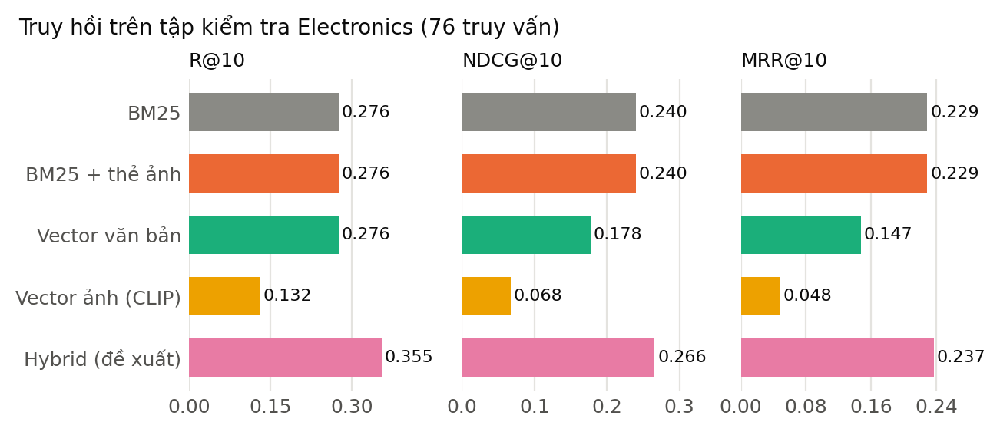

**Hình 2.4. So sánh các phương pháp truy hồi trên tập kiểm tra Electronics.** Thanh xám là baseline BM25; các giá trị trùng với Bảng 2.5. Ba kênh đơn lẻ không vượt BM25 về NDCG@10 và MRR@10, và hybrid đạt giá trị cao nhất trong ba chỉ số, với khoảng bootstrap của chênh lệch NDCG@10 so với BM25 chứa 0.

Dense text có Recall@10 bằng BM25 nhưng NDCG@10 thấp hơn, cho thấy khả năng xuất hiện mục tiêu trong top 10 và vị trí của mục tiêu là hai khía cạnh khác nhau. CLIP đạt Recall@10 thấp nhất trong nhóm trên Electronics, trong khi Coverage@10 cao hơn các phương pháp khác. Độ đa dạng danh sách tăng không đồng nghĩa khả năng tìm lại mục tiêu tăng.

Visual tags thô không làm thay đổi Recall@10, NDCG@10 và MRR@10 so với BM25 trong lần đánh giá này. Sự khác biệt nhỏ về coverage phản ánh thay đổi các ứng viên không phải mục tiêu. Kết quả không hỗ trợ kết luận chỉ bổ sung màu hoặc độ sáng là đủ để cải thiện truy hồi kỹ thuật.

Một mục tiêu công bố duy nhất chỉ đo việc tìm lại mục tiêu đó. Vì các item còn lại chưa được gán nhãn đầy đủ, Precision không được diễn giải thành tỷ lệ tất cả sản phẩm thực sự phù hợp ngoài thực tế.

**Thử nghiệm ngoài miền trên VOGUE.**

**Bảng 2.6. Hiệu năng truy hồi first-turn trên VOGUE.**

| Phương pháp | P@10 | R@10 | NDCG@10 | MRR@10 | Coverage@10 |
| --- | --- | --- | --- | --- | --- |
| bm25 | 0.036667 | 0.366667 | 0.177511 | 0.121197 | 0.972222 |
| dense_text | 0.048333 | 0.433333 | 0.202762 | 0.134339 | 0.972222 |
| clip | 0.048333 | 0.452778 | 0.228636 | 0.169577 | 0.972222 |
| hybrid | 0.048333 | 0.455556 | 0.217505 | 0.145589 | 0.972222 |

*Nguồn số liệu: `rag/artifacts/evaluation/results_vogue_ir_v1/experiment.json`; 60 hội thoại, 36 sản phẩm có metadata.*

Hybrid có Recall@10 bằng 0,455556, còn CLIP đạt NDCG@10 bằng 0,228636, cao hơn hybrid 0,217505 về trị số quan sát. Như vậy, lựa chọn phương pháp tốt nhất thay đổi theo độ đo: fusion tìm lại nhiều mục tiêu hơn về recall trung bình, trong khi CLIP đặt mục tiêu đúng ở vị trí đầu tốt hơn theo NDCG.

Các giá trị trong bảng được biểu diễn trực quan ở Hình 2.5.

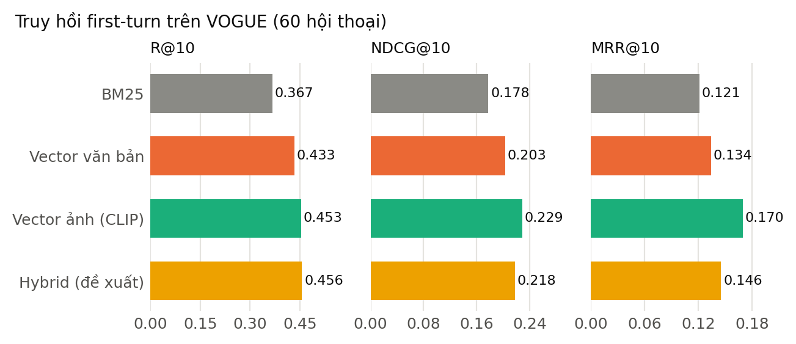

**Hình 2.5. So sánh các phương pháp truy hồi first-turn trên VOGUE.** Trên bộ ngoài miền thời trang, kênh ảnh CLIP có NDCG@10 cao nhất về trị số, khác với Electronics; thứ hạng giữa các phương pháp phụ thuộc vào miền dữ liệu.

Tập catalog nhỏ làm Coverage@10 gần 1 ở tất cả phương pháp, nên chỉ số này có khả năng phân biệt hạn chế trong thiết lập VOGUE. Các hội thoại chia sẻ người tham gia và gold lấy từ lựa chọn cuối, trong khi đầu vào chỉ có lượt seeker đầu. Kết quả là một thử nghiệm thành phần ngoài miền, chưa đánh giá phản hồi tương tác của tác tử hiện tại.

**Chất lượng sinh câu trả lời có viện dẫn.** Pilot thiết kế sáu câu hỏi trên ba nhóm context, mỗi câu có hai arm chữ và chữ–ảnh, tạo 12 đầu ra dự kiến. Có 9 đầu ra được sinh và 8 đầu ra được chấm hợp lệ. Trong 18 request bắt đầu cho pilot, một request chấm bị lỗi quota 429; quá trình gọi dừng và các đầu ra còn thiếu vẫn được giữ trong mẫu số độ bao phủ. Một probe kết nối riêng không được tính là một mẫu câu trả lời của pilot.

**Bảng 2.7. Độ bao phủ và faithfulness của pilot sinh câu trả lời.**

| Chế độ đầu vào | Dự kiến | Sinh được | Chấm hợp lệ | Faithfulness macro/câu | Faithfulness micro/claim |
|---|---:|---:|---:|---:|---:|
| text_only | 6 | 5 | 4 | 0.854167 | 0.945946 |
| text_image | 6 | 4 | 4 | 0.958333 | 0.975610 |

*Nguồn số liệu: `rag/artifacts/evaluation/results_rag_generation_analysis_v1/analysis.json`.*

Tổng cộng bộ chấm ghi nhận 79 nhận định: 75 supported, 3 unsupported và 1 unknown. Faithfulness micro chung bằng 75/78, xấp xỉ 0,961538; faithfulness macro theo câu bằng 0,906250. Answer relevance do cùng provider chấm đạt trung bình 2,00 trên tám câu hợp lệ theo rubric 0–2.

Tỷ lệ unsupported theo claim đã xác định là 2/37 = 0,054054 ở text-only và 1/41 = 0,024390 ở text+image. Đây là chỉ số thay thế theo context, không phải tỷ lệ ảo giác trên thực tế. Các câu phát biểu thiếu bằng chứng đôi khi bị judge đưa vào claim không được hỗ trợ, cho thấy khả năng sai trong chính quá trình chấm.

Chỉ bốn cặp có đầy đủ điểm ở cả hai arm, thuộc hai nhóm context. Vì vậy, chênh lệch faithfulness được báo ở mức mô tả; mẫu hiện tại không đủ để kết luận ảnh làm tăng chất lượng một cách ổn định. Việc chấm do mô hình AI lớn thực hiện (judge OpenAI gpt-4.1-mini và rà soát bổ sung bằng Claude).

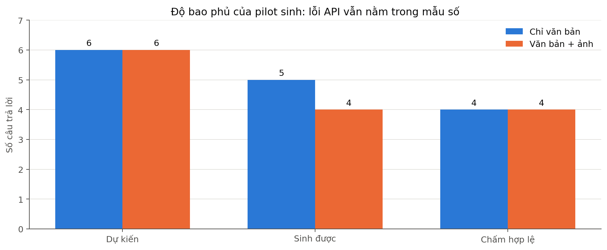

**Hình 2.6. Số đầu ra dự kiến, sinh được và chấm hợp lệ của pilot RAG.**

**Đánh giá sinh mở rộng trên 104 câu trả lời.** Bộ mở rộng theo protocol đã chuẩn bị trước (52 cặp câu hỏi trên 20 nhóm nguồn, trong đó 16 nhóm truy hồi và 4 nhóm bắt buộc từ chối do context rỗng) được chạy bằng OpenAI `gpt-4.1-mini` (phiên bản máy chủ `gpt-4.1-mini-2025-04-14`) cho cả sinh và chấm, nhiệt độ 0, tổng 208 request, chi phí đo từ usage là 0,30 USD. Đây là protocol riêng, khác model với pilot Gemini nên hai đợt không được so trực tiếp. Cả 104 câu đều được sinh và chấm hợp lệ; không request nào lỗi.

**Bảng 2.8. Đánh giá sinh mở rộng theo nhánh đầu vào (judge cùng nhà cung cấp).**

| Nhánh | Câu | Nhận định | Supported | Unsupported (thô) | Unknown | Độ bao phủ judge | Faithfulness micro (thô) | Nhận định được ảnh hỗ trợ |
|---|---:|---:|---:|---:|---:|---:|---:|---:|
| text_only | 52 | 211 | 104 | 18 | 89 | 0.58 | 0.852 | 0 |
| text_image | 52 | 226 | 173 | 10 | 43 | 0.81 | 0.945 | 48 |

*Nguồn số liệu: `rag/artifacts/evaluation/results_rag_generation_expansion_openai_analysis_v1/summary.json`; tỷ lệ unsupported trên nhận định xác định được là 18/122 = 0,148 (text_only) và 10/183 = 0,055 (text_image).*

Chênh lệch faithfulness thô không phản ánh lợi ích của ảnh. Cả 28 nhận định bị judge gắn "không được hỗ trợ" đều là câu từ chối đúng do thiếu bằng chứng (ví dụ "Không có bằng chứng xác nhận một chiếc máy cụ thể còn 95% sức khỏe pin"): judge coi câu "không có bằng chứng" như một khẳng định về sản phẩm cần trích dẫn. Toàn bộ 28 nhận định này nằm ở nhóm câu hỏi về pin và màn hình (faithfulness thô 0,419 ở text_only và 0,773 ở text_image), nơi số câu từ chối bị gắn cờ khác nhau giữa hai nhánh (18 và 10). Ở hai nhóm còn lại, câu hỏi gốc và câu hỏi thị giác, cả hai nhánh đạt 1,000 trên các nhận định xác định được. Như vậy không có nhận định sai nào được judge xác định trong bộ này, nhưng judge cùng nhà cung cấp, nên chưa thể kết luận tỷ lệ ảo giác thực. Một rà soát bổ sung do một mô hình AI lớn khác nhà cung cấp (Claude) thực hiện trên 30 câu chọn theo seed cố định, năm câu cho mỗi cặp loại câu hỏi và nhánh, chấm trước khi xem kết quả judge, cho thấy **ít nhất một lỗi ở 9/30 câu**: ba nhận định không có trong bằng chứng (cổng micro USB cho hai điện thoại, khả năng mở khóa của một máy khóa mạng), hai chỗ nói thiếu thông tin trong khi bằng chứng có (RAM, màu sắc), một chỗ bỏ qua bằng chứng mâu thuẫn về khóa mạng và một chi tiết thị giác không kiểm chứng được. Judge không gắn cờ lỗi nào trong cả chín câu này, trong khi các cờ "không được hỗ trợ" của nó trong mẫu đều là câu từ chối đúng. Như vậy judge tự động vừa bỏ sót lỗi thật vừa gắn cờ nhầm, và việc nó không tìm thấy nhận định sai nào không có nghĩa tỷ lệ ảo giác bằng không. Faithfulness trung bình theo rà soát bổ sung là 0,952 ở nhánh chữ và 0,967 ở nhánh chữ–ảnh (15 câu mỗi nhánh), chênh lệch không đủ để kết luận ảnh làm câu trả lời đúng hơn. Đây là kết quả của một mô hình AI lớn (Claude) trên mẫu nhỏ.

Các giá trị trong bảng được biểu diễn trực quan ở Hình 2.7.

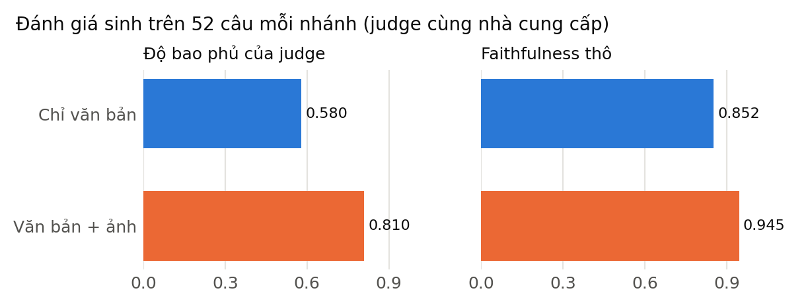

**Hình 2.7. Độ bao phủ của judge và faithfulness thô theo nhánh đầu vào.** Chênh lệch faithfulness thô không chứng minh lợi ích của ảnh vì phần nhận định bị gắn không được hỗ trợ đều là câu từ chối đúng; chỉ độ bao phủ kiểm chứng tăng khi có ảnh.

Tác động quan sát được của ảnh nằm ở **độ bao phủ kiểm chứng**: judge xác định được 81% nhận định ở nhánh chữ–ảnh so với 58% ở nhánh chữ. Với câu hỏi thị giác (màu sắc, vị trí camera) độ bao phủ là 0,97 so với 0,61, trong đó 34 nhận định được ảnh hỗ trợ. Nói cách khác, ảnh làm các mô tả thị giác kiểm chứng được, nhưng không làm câu trả lời đúng hơn theo chỉ số này. Về viện dẫn, không có trích dẫn nào trỏ ra ngoài context; bốn câu mỗi nhánh không có trích dẫn đều thuộc bốn ca context rỗng. Kiểm tra thô 178 giá trị kỹ thuật kèm đơn vị cho thấy 155 giá trị xuất hiện nguyên văn trong bằng chứng; các mẫu lệch đã xem phần lớn do khác định dạng (như 6,1” và 6.1 inch) hoặc lấy từ trường cấu trúc, nhưng chưa xem hết 23 giá trị còn lại.

Giới hạn: câu hỏi do nhóm nghiên cứu thiết kế trên các ca đã được xem, chỉ có 16 nhóm nguồn truy hồi nên không phải mẫu người dùng độc lập; việc chấm do mô hình AI lớn thực hiện nên tỷ lệ ảo giác là chỉ số thay thế. Chênh lệch theo cặp ở nhóm câu hỏi pin (9/14 cặp nhánh ảnh cao hơn, 1 cặp thấp hơn) chỉ mang tính mô tả và chịu ảnh hưởng của lỗi gắn cờ nêu trên.

**Answer Relevance của đợt sinh 104 câu.** Điểm rubric 0/1/2 do judge gán bằng 2 cho cả 104 câu ở cả hai nhánh, nên thang này bão hòa và không phân biệt được các câu trả lời. Vì vậy độ liên quan được đo thêm bằng phương pháp câu hỏi ngược (104 yêu cầu, chi phí khoảng 0,03 USD, cùng mô hình gpt-4.1-mini và encoder MiniLM đã cố định).

**Bảng 2.9. Answer Relevance theo phương pháp câu hỏi ngược trên 104 câu trả lời.**

| Nhánh | Số câu | Relevance trung bình | Số câu không cam kết | Relevance (không tính câu không cam kết) |
| --- | --- | --- | --- | --- |
| text_only | 52 | 0.617966 | 24 | 0.648638 |
| text_image | 52 | 0.612966 | 21 | 0.638443 |

*Nguồn số liệu: `rag/artifacts/evaluation/results_answer_relevance_openai_v1/summary.json`; chênh lệch ghép cặp theo cặp câu hỏi trong cùng tệp.*

Chênh lệch text_image trừ text_only là −0,004999 với khoảng bootstrap 95% [−0,032343; +0,018817] trên 52 cặp, chứa 0, nên ảnh không làm thay đổi độ liên quan có ý nghĩa. Độ liên quan phụ thuộc mạnh vào loại câu hỏi: câu hỏi gốc đạt 0,810547 (text_only) và 0,830182 (text_image), trong khi câu hỏi về điều kiện thiết bị đạt 0,517918 và 0,514681, và câu hỏi thị giác đạt 0,477288 và 0,439732. Hai nhóm sau chủ yếu là các câu từ chối do thiếu bằng chứng, nên điểm thấp ở đó không đồng nghĩa với câu trả lời lạc đề. Đây là phương pháp tự xây dựng với mô hình cùng nhà cung cấp, không phải cài đặt Ragas chính thức.

#### 2.6.3.2. Đánh giá độ chính xác của hệ gợi ý đa phương thức

Các mô hình có học được đánh giá bằng ba seed trên cùng split Electronics. Popularity là phương pháp xác định nên không có độ lệch chuẩn giữa seed. SD dưới đây mô tả dao động của các lần khởi tạo đã chạy, không phải khoảng tin cậy quần thể.

**Bảng 2.10. Kết quả gợi ý Electronics trung bình và độ lệch chuẩn qua ba seed.**

| Mô hình | HR@10 trung bình | SD theo seed | NDCG@10 trung bình | SD theo seed |
| --- | --- | --- | --- | --- |
| Popularity | 0.046614 | — | 0.020457 | — |
| lightgcn | 0.053974 | 0.005123 | 0.023521 | 0.002182 |
| vbpr | 0.035492 | 0.001983 | 0.016899 | 0.001704 |
| bm3 | 0.046778 | 0.003550 | 0.019849 | 0.001668 |
| graph_text_only | 0.056101 | 0.002319 | 0.024557 | 0.001445 |
| graph_multimodal | 0.053811 | 0.001723 | 0.023308 | 0.000820 |
| graph_multimodal_gcl | 0.046614 | 0.000850 | 0.024809 | 0.001594 |

*Nguồn số liệu: `rag/artifacts/evaluation/results_electronics_multimodal_v1/experiment.json`.*

Graph text-only có HR@10 bằng 0,056101, cao nhất về trị số trong cấu hình được khảo sát. GCL có NDCG@10 bằng 0,024809, nhưng các khác biệt cần được xét bằng phép so ghép cặp. Thêm ảnh vào graph làm HR@10 thay đổi −0,002290, khoảng 95% [−0,005725; 0,001145]; thêm GCL vào graph multimodal làm HR@10 thay đổi −0,007197, khoảng [−0,015865; 0,000818], và NDCG@10 thay đổi +0,001501, khoảng [−0,002845; 0,005618]. Các khoảng này chưa xác nhận cải thiện ổn định.

VBPR có HR@10 thấp hơn LightGCN 0,018482, khoảng [−0,027641; −0,009973]. Trong catalog Electronics đã chọn, tín hiệu ảnh và cấu hình visual factor hiện tại chưa tạo ưu thế so với graph tương tác đơn giản. Kết luận áp dụng cho bản thích nghi và siêu tham số trong nghiên cứu, không phải phủ định chung phương pháp VBPR.

Trên tập điện thoại đã đánh giá trước đó, HR@10 của Popularity, LightGCN, VBPR và BM3 lần lượt xấp xỉ 0,18421; 0,11623; 0,23026 và 0,25439. Graph text-only, graph multimodal và graph multimodal + GCL lần lượt đạt khoảng 0,11842; 0,12719 và 0,15789. GCL cải thiện so với graph tương ứng nhưng chưa vượt BM3. Sự thay đổi giữa hai tập cho thấy cấu trúc tương tác và miền dữ liệu ảnh hưởng đáng kể tới lợi ích của từng thành phần. Thứ hạng cũng khác nhau: ở Electronics graph text-only cao nhất về trị số, còn ở tập điện thoại BM3 và VBPR cao nhất và LightGCN thấp hơn cả Popularity. Hai tập có quy mô và cách chia khác nhau (152 người dùng kiểm tra so với 2.038), nên không so trực tiếp giá trị giữa chúng. Vì điện thoại chỉ có 72 sản phẩm trong tập Electronics theo bộ nhận diện theo quy tắc, kết quả trên Electronics không thay cho kết quả riêng của điện thoại, và kết luận về một ngành hàng không tự chuyển sang ngành hàng khác.

**Tập gợi ý thứ hai: Amazon Baby_Products.** Cùng sáu phương pháp, ba seed và cấu hình (chiều 16, 100 epoch, CPU) được chạy trên bộ Baby để kiểm tra các xu hướng của Electronics có lặp lại ở một ngành hàng khác hay không; 18 checkpoint đều được tái dựng khớp.

**Bảng 2.11. Kết quả gợi ý trên Amazon Baby_Products, trung bình và độ lệch chuẩn qua ba seed.**

| Mô hình | HR@10 trung bình | SD theo seed | NDCG@10 trung bình | SD theo seed |
| --- | --- | --- | --- | --- |
| Popularity | 0.047422 | — | 0.023373 | — |
| lightgcn | 0.054208 | 0.000372 | 0.026865 | 0.000218 |
| vbpr | 0.031574 | 0.001290 | 0.015718 | 0.000576 |
| bm3 | 0.054736 | 0.000845 | 0.026345 | 0.000572 |
| graph_text_only | 0.055711 | 0.002519 | 0.027394 | 0.000634 |
| graph_multimodal | 0.055224 | 0.000761 | 0.027628 | 0.000729 |
| graph_multimodal_gcl | 0.046203 | 0.001273 | 0.023298 | 0.000867 |

*Nguồn số liệu: `rag/artifacts/evaluation/results_amazon2023_baby_v1/experiment.json`; so sánh ghép cặp theo người dùng trong `results_amazon2023_baby_analysis_v1/analysis.json`.*

Các kết quả lặp lại xu hướng của Electronics. Thêm ảnh vào graph làm HR@10 thay đổi −0,000488 với khoảng bootstrap 95% [−0,002194; +0,001097], tức không có bằng chứng ảnh cải thiện; graph text-only hơn LightGCN +0,001504 [−0,000894; +0,003860], khoảng cũng chứa 0. Thêm GCL vào graph multimodal làm HR@10 giảm 0,009021 [−0,012598; −0,005486] và NDCG@10 giảm, khoảng không chứa 0; GCL đạt HR@10 thấp hơn cả Popularity. VBPR thấp hơn LightGCN 0,022634 [−0,026942; −0,018083] và cũng thấp hơn Popularity. Bốn mô hình LightGCN, BM3, graph text-only và graph multimodal có HR@10 trong khoảng 0,0542–0,0557, chênh nhau nhỏ so với độ lệch chuẩn giữa các seed, nên không xếp hạng được chắc chắn giữa chúng. Với 62 mục tiêu test chưa có cạnh train, HR@10 bằng 0 ở mọi mô hình. Các kết luận này áp dụng cho bản thích nghi và siêu tham số của nghiên cứu, trên một mẫu con của một danh mục, và không phải phủ định chung các phương pháp.

**Tập gợi ý thứ ba: MIND-small (tin tức, chỉ văn bản).** Ba phương pháp dùng được với dữ liệu chỉ có văn bản (LightGCN, graph text-only, BM3), ba seed, chiều 16, 100 epoch, CPU; 9 checkpoint đều được tái dựng khớp. Hạn chế của bộ này được nêu ở mục 2.6.1: mẫu 6.000 người dùng, chia từng người dùng thay vì theo lượt hiển thị chính thức, lịch sử đọc không có mốc thời gian.

**Bảng 2.12. Kết quả gợi ý trên MIND-small (test, 6.000 người dùng), trung bình và độ lệch chuẩn qua ba seed.**

| Mô hình | HR@10 | SD | NDCG@10 | SD | HR@20 | NDCG@20 |
| --- | --- | --- | --- | --- | --- | --- |
| Popularity | 0.014333 | — | 0.006067 | — | 0.028167 | 0.009413 |
| lightgcn | 0.021278 | 0.002605 | 0.010992 | 0.001412 | 0.036389 | 0.014696 |
| bm3 | 0.019556 | 0.002562 | 0.010840 | 0.000735 | 0.032111 | 0.013957 |
| graph_text_only | 0.022889 | 0.001084 | 0.011691 | 0.000453 | 0.041389 | 0.016363 |

*Nguồn số liệu: `rag/artifacts/evaluation/results_mind_small_text_v1/experiment.json`; so sánh ghép cặp theo người dùng trong `results_mind_small_text_analysis_v1/analysis.json`.*

Cả ba mô hình học đều có HR@10 cao hơn Popularity (0,0196–0,0229 so với 0,0143), nhưng mức chênh tuyệt đối nhỏ vì mỗi người dùng chỉ có một mục kiểm tra trong gần 20.400 tin. Giữa các mô hình, graph text-only hơn LightGCN +0,001611 ở HR@10 với khoảng bootstrap 95% [−0,000668; +0,004001] và +0,000699 ở NDCG@10 [−0,000489; +0,001927]; cả hai khoảng chứa 0. BM3 thấp hơn LightGCN −0,001722 ở HR@10 [−0,003389; ≈0], mép trên sát 0, và −0,000153 ở NDCG@10 [−0,001206; +0,000860]. Vì vậy chưa có bằng chứng ổn định về thứ hạng giữa ba mô hình; xu hướng quan sát được (graph text-only cao nhất về trị số, BM3 thấp nhất) giống Electronics và Baby nhưng không đủ để khẳng định. Epoch được chọn theo validation cũng không ổn định: BM3 chọn epoch 10, 80 và 10 cho ba seed, LightGCN chọn 90, 30 và 70, graph text-only luôn chọn epoch 100, nên có thể chưa hội tụ ở graph text-only. Với 384 tin mục tiêu chưa có cạnh huấn luyện (6,4% người dùng), HR@10 bằng 0 ở LightGCN và BM3, và 0,004340 ở graph text-only (tổng cộng 5 lượt trúng trên 3 seed × 384 người dùng), nên chưa đủ để kết luận về khởi đầu lạnh. Kết quả này chỉ cho biết các thành phần dùng được cho văn bản; nó không đánh giá phần đa phương thức (ảnh, GCL, truy hồi, Co-Guiding).

Các giá trị trong bảng được biểu diễn trực quan ở Hình 2.8.

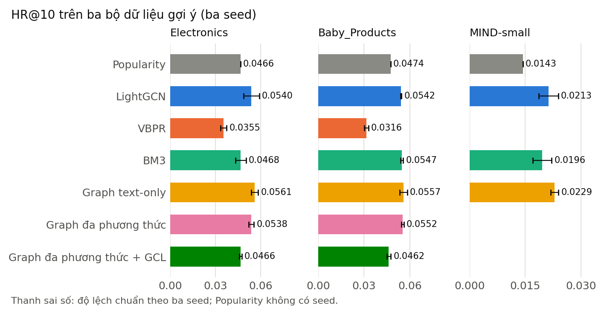

**Hình 2.8. HR@10 của các phương pháp gợi ý trên ba bộ dữ liệu (trung bình ba seed, thanh sai số là độ lệch chuẩn).** Thanh xám là Popularity. Thứ hạng giữa LightGCN, BM3, graph text-only và graph đa phương thức thay đổi theo bộ dữ liệu và chênh lệch nhỏ so với độ lệch chuẩn giữa các seed; VBPR và GCL đa phương thức thấp hơn Popularity ở Baby_Products. MIND-small chỉ gồm ba phương pháp dùng văn bản.

Kết quả không dùng để chọn mô hình triển khai chỉ bằng thứ hạng test. Việc chọn checkpoint và siêu tham số thuộc validation; bảng test phục vụ mô tả khả năng tổng quát hóa theo giao thức đã khóa.

#### 2.6.3.3. Đánh giá hiệu quả của cơ chế tương hỗ Co-Guiding RAG ↔ RecSys

**Phản hồi ở thời điểm suy luận.** Tám arm giữ cùng recommender seed 42, cùng truy vấn và vector cache. Bảng sau phân biệt chất lượng retrieval với feed có điều kiện theo câu hỏi.

**Bảng 2.13. Ảnh hưởng của hai hướng Co-Guiding và guard ở thời điểm suy luận.**

| Chế độ suy luận | Truy hồi R@10 | Truy hồi NDCG@10 | Feed HR@10 | Tỷ lệ từ chối |
|---|---:|---:|---:|---:|
| unguarded/decoupled | 0.355263 | 0.265861 | 0.000000 | 0.000000 |
| unguarded/rag_to_rec | 0.355263 | 0.265861 | 0.289474 | 0.000000 |
| unguarded/rec_to_rag | 0.355263 | 0.249767 | 0.000000 | 0.000000 |
| unguarded/coupled | 0.355263 | 0.249767 | 0.276316 | 0.000000 |
| guarded/decoupled | 0.276316 | 0.213331 | 0.000000 | 0.026316 |
| guarded/rag_to_rec | 0.276316 | 0.213331 | 0.236842 | 0.026316 |
| guarded/rec_to_rag | 0.276316 | 0.199872 | 0.000000 | 0.026316 |
| guarded/coupled | 0.276316 | 0.199872 | 0.236842 | 0.026316 |

**Bảng 2.14. Kết quả ba biến thể joint ban đầu.**

Các giá trị trong bảng được biểu diễn trực quan ở Hình 2.9.

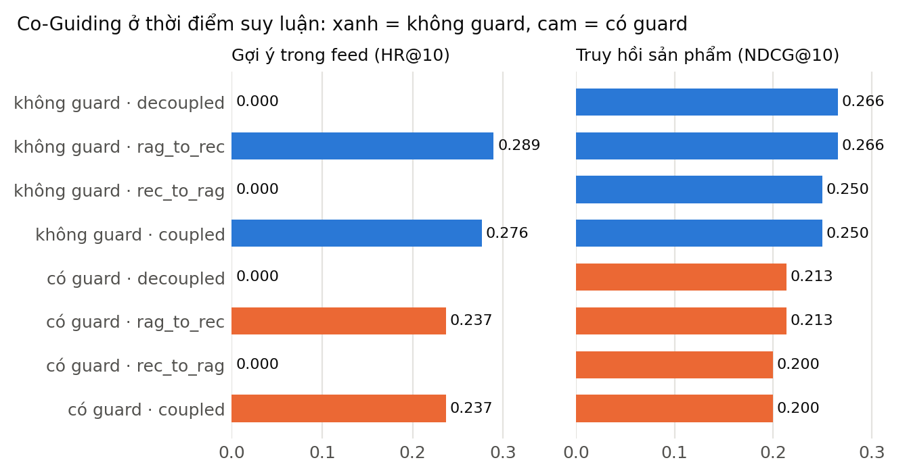

**Hình 2.9. Truy hồi và gợi ý theo chế độ Co-Guiding và guard khi suy luận.** Chiều RAG → RecSys làm HR@10 của feed tăng từ 0 lên 0,289 (không guard) và 0,237 (có guard), trong khi chiều RecSys → RAG làm NDCG@10 truy hồi giảm; guard làm Recall@10 của truy hồi giảm từ 0,355 xuống 0,276 và từ chối 2,6% truy vấn do chưa đủ bằng chứng thỏa ràng buộc.

| Biến thể học | RecSys HR@10 | RecSys NDCG@10 | Query HR@10 | Query NDCG@10 |
|---|---:|---:|---:|---:|
| gradient_decoupled | 0.043834 | 0.023244 | 0.004386 | 0.001462 |
| joint_retrieval | 0.037946 | 0.020229 | 0.000000 | 0.000000 |
| joint_bidirectional | 0.037455 | 0.019927 | 0.000000 | 0.000000 |

*Nguồn số liệu: `rag/artifacts/evaluation/results_electronics_coupling_v1/experiment.json` và `rag/artifacts/evaluation/results_electronics_joint_v1/experiment.json`; bảng thứ nhất là inference, bảng thứ hai là huấn luyện joint.*

Ở chế độ không guard, RAG → RecSys nâng feed HR@10 từ 0 lên 0,289474; coupled đạt 0,276316. Đây là khả năng tìm lại mục tiêu theo truy vấn hiện tại, không phải chất lượng gợi ý dài hạn của toàn bộ người dùng. Hướng RecSys → RAG làm retrieval NDCG@10 giảm từ 0,265861 xuống 0,249767. Chênh lệch −0,016094 có khoảng bootstrap [−0,038172; −0,000301]. Ghép hai chiều vì vậy chưa vượt cấu hình chỉ RAG → RecSys trong thiết lập này.

Khi bật guard ở chế độ decoupled, Recall@10 giảm từ 0,355263 xuống 0,276316; tỷ lệ từ chối là 2/76. Có bốn query mà mục tiêu thiếu dữ kiện kiểm tra và sáu query mà mục tiêu bị parser xem là vi phạm. Những trạng thái này do bộ phân tích ràng buộc theo quy tắc xác định; việc lọc mạnh hơn không tự chứng minh tăng tính đúng ngoài thực tế.

**Học kết hợp ban đầu.** Ba arm joint dùng ba seed, 100 epoch và tiêu chí chọn checkpoint tổng hợp. Hai arm cho query loss cập nhật graph có query test HR@10 bằng 0, trong khi query train HR@10 tại checkpoint chọn đạt 0,998355–1,0. Gradient-decoupled có query test HR@10 bằng 0,004386. Khoảng cách lớn cho thấy biểu hiện học thuộc mục tiêu train và thiếu khả năng tổng quát hóa.

Query loss cập nhật graph còn làm giảm RecSys HR@10 so với decoupled: joint-retrieval chênh lệch −0,005888, khoảng [−0,011286; −0,000818]; joint-bidirectional chênh lệch −0,006379, khoảng [−0,011613; −0,001472]. Cả sáu mục tiêu query test có tương tác train cũng không được tìm lại trong top 10 của hai arm joint, nên hiện tượng không được quy hoàn toàn cho cold item.

Kiểm tra trùng văn bản sau casefold và chuẩn hóa khoảng trắng ghi nhận 0/76 query validation và 0/76 query test xuất hiện trong 608 query train. Phép kiểm loại một dạng trùng literal, nhưng không loại hoàn toàn tương đồng ngữ nghĩa hoặc trùng trong dữ liệu tiền huấn luyện encoder.

**Biến thể giữ nền ngữ nghĩa.** Validation chọn alpha chung 0,1 với composite trung bình 0,136793; alpha 0,3 đạt 0,087848. Sau khi khóa lựa chọn, chín run thuộc alpha được chọn mới được chấm test. Tổng 18 checkpoint trong lưới được kiểm chứng tái dựng.

**Bảng 2.15. Kết quả các biến thể giữ nền tại alpha được chọn bằng validation.**

| Arm | Rec HR@10 | Rec NDCG@10 | Query HR@10 | Query NDCG@10 |
|---|---:|---:|---:|---:|
| Frozen text | — | — | 0.276316 | 0.177600 |
| residual_detached | 0.043507 | 0.023997 | 0.254386 | 0.160551 |
| residual_joint | 0.045469 | 0.024986 | 0.197368 | 0.134504 |
| residual_bidirectional | 0.046614 | 0.025268 | 0.192982 | 0.133490 |

**Bảng 2.16. Chênh lệch truy hồi query so với frozen text.**

| Phép so sánh query | Độ đo | Chênh lệch trung bình | Khoảng 95% ghép cặp theo user |
|---|---|---:|---|
| residual_joint_minus_frozen_text | hr@10 | -0.078947 | [-0.140351; -0.030702] |
| residual_joint_minus_frozen_text | ndcg@10 | -0.043096 | [-0.072282; -0.019433] |
| residual_bidirectional_minus_frozen_text | hr@10 | -0.083333 | [-0.149123; -0.030702] |
| residual_bidirectional_minus_frozen_text | ndcg@10 | -0.044110 | [-0.074179; -0.019825] |

*Nguồn số liệu: `rag/artifacts/evaluation/results_electronics_anchored_analysis_v1/analysis.json`.*

Query HR@10 của frozen text là 0,276316, cao hơn residual-detached 0,254386, residual-joint 0,197368 và residual-bidirectional 0,192982. Biến thể giữ nền tránh kết quả gần 0 của head ban đầu, nhưng chưa vượt nền mà nó kế thừa. Đối chiếu joint với detached cũng cho chênh lệch query HR@10 bằng −0,057018, khoảng [−0,100877; −0,021930].

RecSys HR@10 của residual-joint cao hơn detached 0,001963, khoảng [−0,001963; 0,006052], chưa xác nhận cải thiện. Do đó, chưa có bằng chứng tối ưu đồng thời truy hồi và gợi ý. Các biến thể này giữ vai trò thí nghiệm, không được xem là mô hình phục vụ đã chứng minh ưu thế.

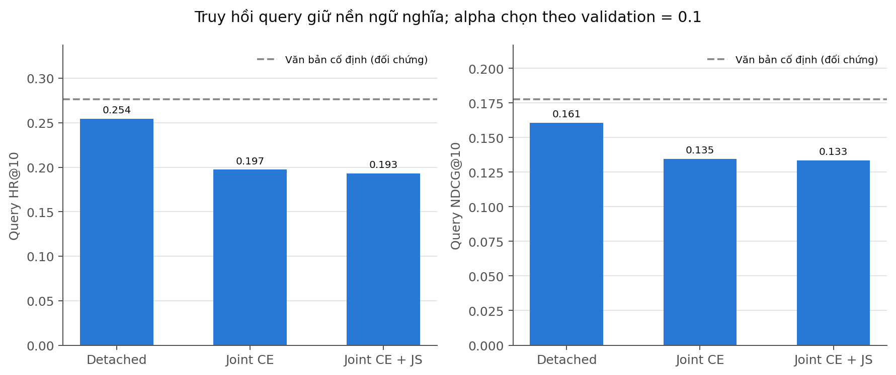

**Hình 2.10. Query retrieval sau lựa chọn alpha bằng validation; đường tham chiếu là frozen text.**

**Đối chứng dùng nội dung lịch sử.**

**Bảng 2.17. Đối chứng bổ sung hồ sơ nội dung lịch sử tại beta được chọn.**

| Ranker | HR beta=0 | HR beta chọn | NDCG beta=0 | NDCG beta chọn |
|---|---:|---:|---:|---:|
| frozen_text | 0.276316 | 0.276316 | 0.177600 | 0.177600 |
| residual_detached | 0.254386 | 0.254386 | 0.160551 | 0.160551 |
| residual_joint | 0.197368 | 0.197368 | 0.134504 | 0.134504 |
| residual_bidirectional | 0.192982 | 0.192982 | 0.133490 | 0.133490 |

Validation chọn beta bằng 0. Mean validation NDCG@10 tại beta 0; 0,1; 0,3 lần lượt là 0,247666; 0,242382 và 0,212426. Cấu hình được chọn vì vậy giữ nguyên điểm không cộng prior lịch sử. Kết quả chưa ủng hộ phép cộng hồ sơ trung bình áp dụng đồng loạt cho mọi query; nó không phủ định mọi cơ chế cá nhân hóa.

Hồ sơ chỉ dùng item train của đúng người dùng. Lịch sử review trong benchmark không được gán thành sở thích của một người truy cập web mới. Đối chứng không huấn luyện lại encoder hoặc graph, nên không phải bằng chứng về lợi ích gradient joint.

### 2.6.4. Nghiên cứu triệt tiêu

#### 2.6.4.1. Đánh giá đóng góp của thành phần ảnh và ảnh hưởng của độ thưa

Đối chứng graph text-only với graph multimodal cô lập tác động của ảnh; đối chứng graph multimodal với cùng graph có GCL cô lập tác động mục tiêu tương phản. Mọi phương pháp dùng cùng split, metadata và ngân sách epoch. Các kết quả full view ở mục 2.6.3.2 cho thấy thêm thành phần không mặc định làm tăng hiệu năng.

Phép làm thưa bổ sung kiểm tra giả thuyết GCL phát huy lợi ích khi phản hồi ít. Ba mức giữ mục tiêu và hai mask tạo sáu điều kiện dữ liệu. Mỗi điều kiện gồm hai mô hình và ba seed, tổng 36 run; sáu run mức 50% mask đầu được kế thừa từ phép thử đã hoàn thành.

**Bảng 2.18. Kết quả từng mask và mức giữ tương tác huấn luyện.**

| Giữ mục tiêu | Mask | Giữ thực tế | MM HR@10 | GCL HR@10 | MM NDCG@10 | GCL NDCG@10 |
|---|---|---:|---:|---:|---:|---:|
| 25% | 20261108 | 31.35% | 0.023553 | 0.032058 | 0.012014 | 0.015776 |
| 25% | 20261109 | 31.35% | 0.026660 | 0.030422 | 0.013471 | 0.014404 |
| 50% | 20261108 | 57.67% | 0.038927 | 0.044979 | 0.017236 | 0.023147 |
| 50% | 20261109 | 57.67% | 0.039254 | 0.039091 | 0.019345 | 0.018606 |
| 75% | 20261108 | 85.89% | 0.051685 | 0.043180 | 0.022804 | 0.021641 |
| 75% | 20261109 | 85.89% | 0.048741 | 0.041708 | 0.021681 | 0.021675 |

**Bảng 2.19. Chênh lệch GCL và MM sau tổng hợp seed và mask.**

| Tỷ lệ giữ mục tiêu | Độ đo | GCL trừ MM | Khoảng 95% ghép cặp theo user |
|---|---|---:|---|
| 25% | hr@10 | +0.006133 | [+0.002451; +0.009977] |
| 25% | ndcg@10 | +0.002347 | [+0.000483; +0.004268] |
| 50% | hr@10 | +0.002944 | [-0.002781; +0.008346] |
| 50% | ndcg@10 | +0.002586 | [-0.000532; +0.005616] |
| 75% | hr@10 | -0.007769 | [-0.015702; -0.000652] |
| 75% | ndcg@10 | -0.000584 | [-0.004694; +0.003221] |

*Nguồn số liệu: `rag/artifacts/evaluation/results_electronics_robustness_analysis_v1/analysis.json`.*

Ở tỷ lệ mục tiêu 25%, số cạnh thực tế còn 3.160/10.080, tương đương 31,35%. HR@10 trung bình qua hai mask của graph MM là 0,025106; GCL đạt 0,031240. NDCG@10 tương ứng 0,012743 và 0,015090. Khoảng chênh lệch của cả HR và NDCG không chứa 0 trong phép bootstrap có điều kiện, hỗ trợ lợi ích của GCL ở mức thưa mạnh này.

Ở tỷ lệ mục tiêu 50%, còn 5.813 cạnh, tương đương 57,67%. MM đạt HR@10 bằng 0,039091 và NDCG@10 bằng 0,018290; GCL đạt 0,042035 và 0,020877. Tuy chênh lệch trung bình dương, các khoảng của cả hai độ đo đều chứa 0 sau khi bổ sung mask thứ hai.

Ở tỷ lệ mục tiêu 75%, còn 8.658 cạnh, tương đương 85,89%. HR@10 của MM là 0,050213, còn GCL là 0,042444. Khoảng chênh lệch HR [−0,015702; −0,000652] nghiêng về MM. Chênh lệch NDCG chưa rõ vì khoảng chứa 0. Như vậy, kết quả không hỗ trợ sử dụng GCL như một cải thiện đồng nhất trên mọi mức thiếu dữ liệu.

Trong phép thử một mask 50% ban đầu, NDCG@10 của GCL cao hơn MM 0,005912 với khoảng [0,002301; 0,009559]. Kết luận mở rộng thay đổi sau khi trung bình hai mask: khoảng NDCG chứa 0. Việc báo cả hai giai đoạn cho thấy tín hiệu thuận lợi của một mask không đủ đại diện cho biến thiên tăng cường dữ liệu.

So với full view, chênh lệch lợi thế HR của GCL ở mức giữ mục tiêu 25% tăng 0,013330, khoảng [0,003844; 0,023227]. Phép so chênh lệch giữa hai phương pháp ở hai điều kiện hỗ trợ giả thuyết lợi ích phụ thuộc độ thưa. Tuy nhiên, các mức dùng chung heldout, các mask không nhất thiết lồng nhau và số mask chỉ bằng hai. Kết quả chưa xác nhận khả năng xử lý nhiễu xã hội hoặc tổng quát hóa sang mọi phân bố mất phản hồi.

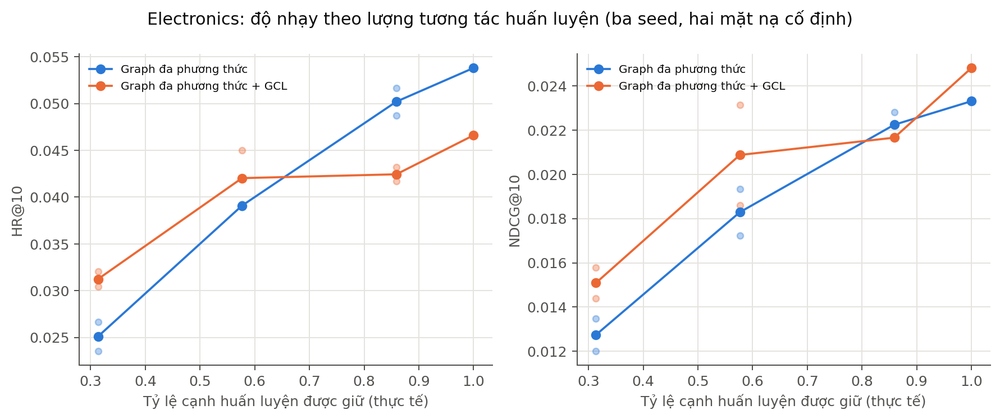

**Hình 2.11. HR@10 và NDCG@10 theo tỷ lệ giữ tương tác; các điểm nhỏ biểu diễn từng mask.**

**Bóc tách thông số bằng nhiều nguồn bằng chứng.** Để kiểm tra trực tiếp liệu bổ sung nguồn có làm bóc tách đặc trưng chính xác hơn hay chỉ làm tăng sai sót, chúng tôi thực hiện thí nghiệm theo giao thức được khóa trước khi chạy tập kiểm tra. Đáp án chuẩn là các trường cấu trúc do người bán nhập trong Amazon Electronics (màu sắc, hãng, kích thước màn hình, hệ điều hành, dung lượng lưu trữ, RAM) và bị loại hoàn toàn khỏi đầu vào. Mô hình (gpt-4.1-mini, nhiệt độ 0, được dặn trả về giá trị rỗng nếu bằng chứng không nêu) chỉ thấy văn bản bài đăng; tùy điều kiện có thêm văn bản của ba bài đăng lân cận lấy bằng BM25 và/hoặc ảnh catalog. Có 346 sản phẩm kiểm tra chọn theo hạn ngạch từng thuộc tính bằng seed cố định, 1,384 request, trong đó một request lỗi mạng không được gọi lại; mốc so sánh là bộ biểu thức chính quy đơn giản chỉ đọc văn bản. Một tập phát triển riêng 89 sản phẩm chỉ dùng để gỡ lỗi đường ống và bộ chấm (quy đổi GB/TB, đồng nghĩa màu, loại các đáp án chuẩn không phải màu) trước khi tập kiểm tra được chạy một lần.

**Bảng 2.20. Bóc tách thông số trên tập kiểm tra theo điều kiện bằng chứng (đúng là tỷ lệ trả lời đúng trên các sản phẩm có đáp án chuẩn; sai là tỷ lệ trả lời sai).**

| Thuộc tính | Sản phẩm | Quy tắc: đúng | Chữ: đúng | Chữ: sai | Chữ + lân cận: đúng | Chữ + ảnh: đúng | Chữ + ảnh: sai |
| --- | --- | --- | --- | --- | --- | --- | --- |
| Màu sắc | 241 | 0.452282 | 0.489627 | 0.058091 | 0.479167 | 0.792531 | 0.145228 |
| Hãng | 337 | 0.801187 | 0.919881 | 0.038576 | 0.931548 | 0.925816 | 0.038576 |
| Kích thước màn hình | 152 | 0.677632 | 0.703947 | 0.046053 | 0.730263 | 0.730263 | 0.059211 |
| Hệ điều hành | 123 | 0.682927 | 0.601626 | 0.056911 | 0.626016 | 0.634146 | 0.065041 |
| Dung lượng lưu trữ | 126 | 0.309524 | 0.738095 | 0.134921 | 0.753968 | 0.769841 | 0.134921 |
| RAM | 98 | 0.377551 | 0.581633 | 0.061224 | 0.581633 | 0.581633 | 0.071429 |

*Nguồn số liệu: `rag/artifacts/evaluation/results_spec_extraction_test_v1/summary.json`.*

Ảnh chỉ cải thiện rõ một thuộc tính là màu sắc: tỷ lệ đúng tăng từ 0,490 lên 0,793 (chênh ghép cặp theo sản phẩm +0,303, khoảng bootstrap 95% [+0,245; +0,361]), nhưng tỷ lệ trả lời sai cũng tăng từ 0,058 lên 0,145 (chênh +0,087, [+0,041; +0,133]). Với 108 sản phẩm mà màu không được nêu trong văn bản, tỷ lệ đúng tăng từ 0,037 lên 0,676 nhưng số câu trả lời sai tăng từ 12 lên 29. Một phần câu sai do đáp án chuẩn nhiễu hoặc khác cách gọi màu; chúng tôi không tách riêng phần này. Như vậy ảnh đổi một phần các trường hợp bỏ trống thành câu trả lời đúng và một phần thành câu trả lời sai. Với năm thuộc tính còn lại, chênh lệch ghép cặp của ảnh nằm trong khoảng từ 0 đến +0,033 và nhiều khoảng chứa 0.

Các giá trị trong bảng được biểu diễn trực quan ở Hình 2.12.

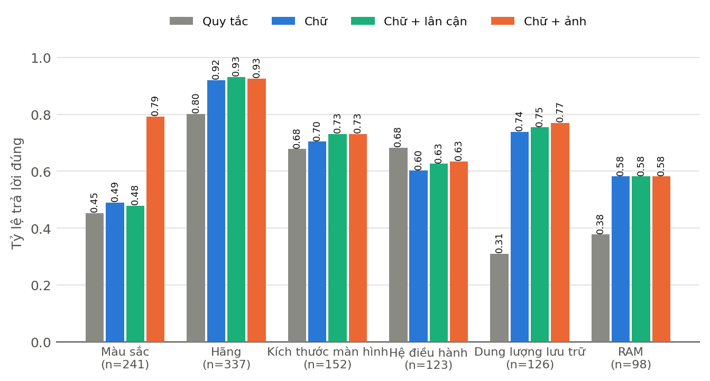

**Hình 2.12. Tỷ lệ bóc tách đúng từng thuộc tính theo điều kiện bằng chứng (tập kiểm tra).** Ảnh chỉ cải thiện rõ thuộc tính màu sắc; văn bản của các bài đăng lân cận không tạo khác biệt. Tỷ lệ trả lời sai được báo cáo trong Bảng 2.20.

Bổ sung văn bản của các bài đăng lân cận không cải thiện kết quả: chênh lệch tỷ lệ đúng của màu là -0,008 ([-0,021; +0,000]) và của dung lượng là +0,016 ([+0,000; +0,040]), và hầu như không câu trả lời nào được mô hình ghi nguồn từ bài đăng lân cận (không quá một câu cho mỗi thuộc tính). Kết quả này phù hợp với nhận định rằng truy xuất phẳng không đem lại thông số của đúng sản phẩm khi các bài đăng tìm được là sản phẩm khác; nó không cho phép kết luận cho trường hợp có nhiều bài đăng cùng một mẫu máy. Khi giá trị không có trong văn bản, không nguồn nào khôi phục được ngoại trừ màu sắc: tỷ lệ đúng chỉ đạt khoảng 0,10 với RAM và dưới 0,27 với bốn thuộc tính phi thị giác.

So với mốc quy tắc, mô hình ngôn ngữ đọc chữ cải thiện rõ dung lượng (0,310 lên 0,738), RAM (0,378 lên 0,582) và giảm tỷ lệ sai của hãng từ 0,199 xuống 0,039, nhưng không vượt mốc quy tắc ở hệ điều hành (0,602 so với 0,683). Giới hạn: đáp án chuẩn do người bán nhập có thể sai hoặc thiếu; chấm lỏng với màu, hãng và hệ điều hành; một mô hình duy nhất; mẫu theo hạn ngạch thiết kế, không đại diện toàn catalog; ảnh là ảnh catalog chứ không phải ảnh bài đăng thực tế.

#### 2.6.4.2. Đánh giá ảnh hưởng của Query Understanding và Reranking

Trên bộ kiểm tra điện thoại, P@10 của BM25, hybrid và rewrite + guard lần lượt là 0,428125; 0,568750 và 0,928125. Cả nhãn liên quan tự động và guard đều dựa vào các trường metadata, do đó kết quả chủ yếu đo tính nhất quán của pipeline với nguồn có cấu trúc. Một số sửa đổi được thực hiện sau khi đã xem test, nên các kết quả này mang tính phát triển và hồi quy, không phải phép xác nhận độc lập cho khả năng hiểu ngôn ngữ.

Tám arm Co-Guiding trên Electronics giữ nguyên truy vấn và query vector, chỉ thay hướng phản hồi và guard. Recall giảm khi bật guard phản ánh đánh đổi giữa kiểm soát ràng buộc và giữ đủ mục tiêu. Các trường hợp unknown và violation được báo riêng để phân biệt dữ liệu thiếu với điều kiện không thỏa. Việc một mục tiêu bị loại do trường thiếu không đồng nhất với sản phẩm thật sự không phù hợp.

Các kiểm tra trạng thái ở điện thoại bổ sung bằng chứng về thay hãng, thay dung lượng, phủ định, reset và tham chiếu danh sách. Phạm vi là tính đúng chức năng của planner và bộ lọc, chưa đo mức hài lòng trong hội thoại tự nhiên.

#### 2.6.4.3. Đánh giá tính độc lập khi ngắt kết nối Co-Guiding

Có hai cấp triệt tiêu. Ở suy luận, bốn chế độ bật/tắt hai hướng trao đổi kiểm tra tác động của tái xếp hạng. Ở huấn luyện, detached, joint và bidirectional giữ cùng query head nhưng thay đường gradient và alignment. Hai cấp không được gộp thành một kết quả chung vì chúng thay đổi cơ chế khác nhau.

Trong thực nghiệm suy luận, RAG → RecSys hữu ích cho feed theo query, còn RecSys → RAG làm giảm retrieval NDCG. Trong thực nghiệm huấn luyện, query loss cập nhật graph làm giảm khả năng tổng quát hóa của head ban đầu. Biến thể giữ nền đưa điểm truy hồi trở lại mức đáng kể nhưng vẫn thấp hơn frozen text và detached control. Như vậy, đóng góp của nền ngữ nghĩa được tách khỏi đóng góp của joint learning.

Rule pilot trước đó có query HR@10 xấp xỉ 0,8728 nhưng 294/304 câu đánh giá trùng văn bản train. Điểm này không được sử dụng để kết luận tổng quát hóa hội thoại. Nó minh họa rủi ro đánh giá bằng câu sinh theo quy tắc gần với dữ liệu học. Các kết quả chính ưu tiên nguồn mô phỏng công khai có cohort và kiểm tra trùng literal rõ ràng.

### 2.6.5. Phân tích định tính và phân tích lỗi

#### 2.6.5.1. Phân tích tình huống mẫu

**Hội thoại kỹ thuật điện thoại.** Bộ chức năng gồm 20 lượt kiểm tra do người nghiên cứu thiết kế; 20/20 lượt đạt điều kiện đã xác định. Chuỗi từ truy vấn Samsung 128 GB sang 256 GB rồi thêm RAM kiểm việc thay giá trị và giữ ngữ cảnh. Câu phủ định hãng kiểm loại điều kiện cũ; lệnh bắt đầu lại kiểm reset. Tham chiếu “máy đầu tiên” hoặc “so sánh hai máy” được giải trên ID kết quả ở lượt trước. Các kết quả xác nhận chức năng trong các kịch bản đã thiết kế.

*Nguồn số liệu: `rag/artifacts/evaluation/results_handset_dialogues_v2/functional_cases.json`.*

**Bằng chứng thị giác trong câu trả lời sinh.** Ở nhóm `samsung128_vi_0`, context gồm S20+ (`B08FRT6G9W`), M51 (`B08WCTYSDF`) và A51 (`B09SZRGR28`). Arm text-only sử dụng tên màu trong văn bản và nêu thiếu bằng chứng vị trí camera. Arm text+image nhận ảnh của hai sản phẩm đầu, tạo mô tả camera sau của S20+ và camera trước của M51, đồng thời nêu chưa có ảnh đủ để xác định vị trí camera A51.

Nhận định dựa ảnh được gắn với image_id và doc_id cụ thể. Tuy nhiên, judge gắn unsupported cho một số phát biểu nói thiếu ảnh/bằng chứng. Tình huống cho thấy kiểm hợp lệ tham chiếu không loại hết sai lệch ngữ nghĩa của bộ chấm. Nó cũng cho thấy phạm vi quan sát chỉ gồm ảnh catalog đã gửi, không hỗ trợ kết luận thiết bị đã sửa hay còn nguyên trạng.

*Nguồn tình huống: `rag/artifacts/evaluation/results_rag_generation_pilot_v1/records.jsonl`; cặp `samsung128_vi_0_visual`.*

**Truy hồi ngoài miền.** Các tình huống VOGUE sau dùng lượt seeker đầu và vị trí mục đầu tiên thuộc gold lựa chọn cuối. Mô tả tiếng Việt là diễn giải nội dung nhu cầu trong báo cáo, không phải trích nguyên văn người tham gia.

**Bảng 2.21. Các tình huống truy hồi VOGUE và thứ hạng mục tiêu.**

| Hội thoại | Nhu cầu tại lượt đầu | Rank BM25 | Rank CLIP | Rank hybrid |
|---|---|---:|---:|---:|
| 10 | Trang phục phù hợp buổi ăn tối tại nhà bạn | 11 | 1 | 7 |
| 11 | Giày dùng ngoài trời | 23 | 9 | 11 |
| 13 | Trang phục cho buổi đi hái táo | 17 | 21 | 29 |
| 15 | Trang phục đi làm casual, thoải mái và không quá ngắn tay | 20 | 12 | 23 |

Ở hai tình huống đầu, hybrid đưa mục tiêu gần hơn BM25 nhưng chưa tốt bằng CLIP riêng. Hai tình huống sau cho thấy fusion có thể làm giảm thứ hạng. Các ví dụ được chọn để minh họa cả hai chiều biến thiên, không được xem là mẫu đại diện thay cho thống kê trên 60 hội thoại.

#### 2.6.5.2. Nhận diện các ca thất bại và hạn chế còn tồn tại

**Sản phẩm thiếu tương tác.** Electronics có 235 mục tiêu test chưa có cạnh train: 203 thuộc người dùng bổ sung và 32 thuộc 38 người dùng có query test. Trong RecSys-only, tất cả sáu mô hình và Popularity có HR@10 bằng 0 trên nhóm 235 mục tiêu này. Metadata và ảnh sẵn có theo transductive chưa đủ để giải quyết cold item trong các cấu hình đã chạy.

**Lịch sử người dùng ngắn.** Ở tập điện thoại, 119/152 người dùng test chỉ có một item train; chín mục tiêu ít phổ biến có HR@10 bằng 0 ở các phương pháp đã chạy. Số liệu chỉ mô tả phân tầng của tập con, chưa xác lập nguyên nhân duy nhất của thất bại.

**Thông số nghi vấn.** Có 118 item điện thoại được đánh dấu cần kiểm tra RAM. Thí nghiệm cách ly trường RAM cấu trúc của 117 item chưa cho cải thiện HR rõ ràng; khoảng chênh lệch chứa 0. Việc phát hiện một trường đáng nghi không đồng nghĩa xác định được giá trị thay thế đúng.

**Truy vấn thiếu thông tin.** Một số first query mô phỏng chỉ nói nhu cầu tổng quát hoặc nhắc các sản phẩm từng mua. Các lượt sau có thể phản hồi danh sách ứng viên của trợ lý trong transcript nguồn. Ghép các lượt đó vào first query sẽ thay đổi thời điểm dự đoán và có thể tiết lộ mục tiêu; chúng không được dùng trong đầu vào hiện tại.

**Học thuộc và xung đột mục tiêu.** Query head ban đầu gần hoàn hảo trên train nhưng gần 0 trên test. Thành phần giữ nền giảm suy sụp, song joint vẫn kém nền và detached control. Các dấu hiệu phù hợp với khả năng giám sát query ít, mục tiêu phụ làm thay đổi biểu diễn bất lợi và ý định hiện tại không trùng hoàn toàn sở thích dài hạn. Các cách giải thích này là giả thuyết, chưa được tách nguyên nhân bằng thí nghiệm nhân quả.

**Sai lệch nhãn và độ đại diện.** Catalog cố định được chọn từ nguồn phụ; người dùng bổ sung có điều kiện hoạt động tối thiểu. Qrels Electronics chỉ có một target/query, VOGUE dùng lựa chọn cuối và nhiều hội thoại chia sẻ participant. Các yếu tố làm giới hạn khả năng suy rộng sang toàn bộ người mua thiết bị điện tử.

**Đánh giá sinh và dữ liệu ảnh.** Pilot nhỏ, cùng provider sinh/chấm và bị thiếu đầu ra do quota. Một rà soát bổ sung do mô hình AI lớn (Claude) thực hiện trên chín đầu ra đã sinh (một người chấm, đã biết cờ của judge) cho thấy cả ba nhận định bị judge đánh dấu không được hỗ trợ đều là câu từ chối đúng do thiếu bằng chứng, trong khi một lỗi dữ kiện thật (gán 128 GB cho cả hai biến thể RAM của một mẫu có biến thể 6 GB đi với 64 GB) và một nhận định không có bằng chứng về pin không bị judge gắn cờ. Do đó chênh lệch faithfulness giữa hai arm ở Bảng 2.7 không được dùng làm bằng chứng về lợi ích của ảnh. Ảnh catalog không thay thế ảnh thiết bị thực tế từ bài đăng và không cung cấp nhãn hư hỏng. Vì vậy, khả năng tư vấn ảnh tình trạng máy, hiệu quả hội thoại tương tác và độ chính xác ngoài đời chưa được kết luận.

**Thiếu video và âm thanh.** Hệ thống chưa xử lý video (đánh giá, kiểm tra máy) và âm thanh; các kết luận về lợi ích của dữ liệu thị giác chỉ áp dụng cho ảnh catalog tĩnh. Điều kiện dữ liệu dẫn đến lựa chọn này được nêu ở mục 1.3.1.

**Độ tin cậy của phát triển lặp.** Một số cấu hình follow-up được xây sau khi kết quả test của đợt trước đã được quan sát. Chọn alpha hoặc beta bằng validation trong follow-up không khôi phục hoàn toàn tính độc lập của quần thể test. Các kết quả này được báo như nghiên cứu phát triển; xác nhận phương pháp cải tiến cần cohort mới.

### 2.6.6. Đánh giá độ trễ và chi phí tính toán

Phép đo Electronics dùng 12 query validation chọn theo ID cố định, CPU hai luồng. Pha search và anchored ranking có một vòng warmup rồi bốn vòng ghi nhận, tổng 48 mẫu/pha. Pha encoder có một truy vấn warmup và 12 truy vấn đo. Các pha được chạy lần lượt khi job train đã dừng.

**Bảng 2.22. Độ trễ từng pha của hệ thống trên Electronics.**

| Pha | Số mẫu | Trung vị ms | p95 ms |
|---|---:|---:|---:|
| search | 48 | 41.406 | 57.405 |
| text | 12 | 33.823 | 44.646 |
| clip | 12 | 54.807 | 79.082 |
| anchored | 48 | 2.935 | 4.139 |

*Nguồn số liệu: `rag/artifacts/evaluation/results_electronics_latency_v1/{search,text,clip,anchored}.json`.*

Search sử dụng query vector đã cache, nên số đo không gồm mã hóa truy vấn. Text và CLIP đo mã hóa thật. Anchored ranking sử dụng vector sản phẩm đã export, chưa gồm làm mới graph, guard, planner, truyền tải web hoặc generation. Trung vị các pha không được diễn giải là latency toàn hệ thống; tổng các phân vị p95 riêng cũng không phải p95 end-to-end.

Các giá trị trong bảng được biểu diễn trực quan ở Hình 2.13.

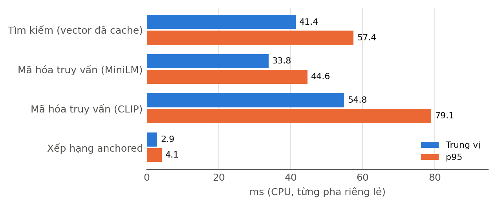

**Hình 2.13. Độ trễ trung vị và p95 của từng pha trên CPU.** Các pha được đo riêng lẻ và không cộng thành thời gian đầu–cuối của một yêu cầu web.

Thời gian nạp model được tách khỏi inference: MiniLM khoảng 31,225 giây và CLIP khoảng 7,854 giây trong hai tiến trình. Trạng thái cache và điều kiện tải khác nhau nên các giá trị không được dùng để xếp hạng tốc độ nạp giữa hai encoder.

Kết quả phone trước đó có trung vị/p95 search cached 3,746/5,073 ms, MiniLM encode 22,587/30,821 ms và CLIP encode 29,806/57,966 ms. Chênh lệch với Electronics liên quan quy mô catalog, truy vấn và điều kiện đo; hai tập không tạo phép so tốc độ mô hình được kiểm soát hoàn toàn.

Trong 18 run RecSys chính Electronics, peak RSS tiến trình train được ghi từ 358,879 đến 445,836 MiB. Sáu run sparse ban đầu ghi từ 336,988 đến 351,441 MiB. Các giá trị không gồm toàn bộ bộ nhớ hệ điều hành hoặc đỉnh bộ nhớ khi nạp encoder. Thời gian train có cả validation và lưu checkpoint; một số job chạy đồng thời, nên thời gian giữa các mô hình chưa tạo benchmark huấn luyện có kiểm soát.

Về độ phức tạp, so cosine trực tiếp toàn catalog có chi phí xấp xỉ $O(|\mathcal I|d)$ và sắp xếp toàn bộ có chi phí $O(|\mathcal I|\log|\mathcal I|)$. Lan truyền sparse qua $L$ lớp có chi phí gần $O(L|\mathcal E|d)$ cho một forward. Ma trận InfoNCE có chi phí $O(B^2d)$ theo số node đối chiếu nên được giới hạn kích thước. Các ước lượng này mô tả thành phần thuật toán, không thay số đo end-to-end.

Các cấu hình graph nhỏ với feature tiền tính đã huấn luyện thành công bằng CPU. Kết quả không suy rộng thành yêu cầu phần cứng cho toàn Amazon, fine-tune encoder hoặc mô hình ngôn ngữ lớn. Chưa có phép đo tải đồng thời, SLA web hoặc latency sinh Gemini được kiểm soát trong nghiên cứu này.

## Thảo luận kết quả và tiểu kết chương 2

Kết quả RQ1 cho thấy truy hồi lai đạt điểm trung bình cao hơn từng kênh trên Electronics ở một số độ đo, nhưng khoảng ghép cặp chưa xác nhận ưu thế NDCG@10 so với BM25. VOGUE cho thấy tín hiệu thị giác có thể hữu ích trong miền có nhu cầu ngoại hình, đồng thời từng tình huống cho thấy fusion vẫn có thể làm giảm thứ hạng. Lợi ích của đa phương thức phụ thuộc loại truy vấn, bằng chứng và cách kết hợp.

Đối với RQ2, graph text-only có HR@10 cao nhất trong nhóm mô hình được học trên toàn bộ Electronics ở cấu hình khảo sát. Bổ sung ảnh hoặc GCL không tạo cải thiện đồng nhất trên toàn tập. Khi train bị làm thưa mạnh, GCL có lợi thế rõ hơn so với cùng graph không GCL trong khoảng bootstrap có điều kiện. Ở mức thiếu nhẹ hơn, lợi thế không còn ổn định hoặc đổi dấu. Kết quả hỗ trợ một giả thuyết phụ thuộc điều kiện, không xác nhận GCL luôn tốt hơn.

Đối với RQ3, luồng RAG → RecSys cải thiện khả năng tìm lại mục tiêu theo truy vấn của bảng gợi ý, trong khi thêm prior RecSys vào truy hồi làm giảm NDCG trên cohort đã đánh giá. Học kết hợp ban đầu có dấu hiệu học thuộc mạnh; biến thể giữ nền ngữ nghĩa hạn chế suy sụp nhưng chưa vượt frozen text và chưa chứng minh tối ưu đồng thời. Điều này cho thấy kết nối kiến trúc và truyền gradient chưa đủ để bảo đảm hai nhiệm vụ có mục tiêu tương thích.

Pilot sinh xác nhận hệ thống đã tạo câu trả lời với bằng chứng chữ và ảnh trong các điều kiện được ghi nhận. Quy mô nhỏ, đầu ra thiếu vì quota và cách chấm cùng provider hạn chế khả năng suy rộng. Chênh lệch điểm giữa hai arm chỉ được xem là kết quả mô tả phát triển. Khả năng xử lý ảnh tình trạng thiết bị, hiệu quả hội thoại tương tác và tác động đến người dùng thực vẫn nằm ngoài phạm vi bằng chứng hiện có.

Nhìn chung, kết quả định vị thành phần truy hồi và kiểm ràng buộc như nền phục vụ có thể kiểm tra; đồ thị, GCL và joint learning được phân tích theo đối chứng thay vì giả định có lợi ngay từ thiết kế. Những phát hiện âm góp phần xác định điều kiện cần cho nghiên cứu tiếp theo: dữ liệu tương tác phù hợp hơn với mục tiêu hội thoại, nhãn liên quan đầy đủ hơn, cơ chế cân bằng ý định với sở thích và quần thể kiểm định mới khi thay đổi phương pháp.

# KẾT LUẬN

Nghiên cứu đã xây dựng và thực nghiệm một khung GNN–GCL–Multimodal RAG gồm biểu diễn văn bản–ảnh–thông số, truy hồi lai, kiểm ràng buộc, gợi ý trên đồ thị dị thể và các cơ chế kết hợp hai nhánh. Hệ thống sử dụng encoder có sẵn để tách ảnh hưởng của biểu diễn nền khỏi ảnh hưởng của học đồ thị và query head. Dữ liệu, split, cấu hình, checkpoint và kết quả được liên kết bằng định danh và hash để phục vụ tái lập.

Các kết quả xác nhận khả năng triển khai và đánh giá riêng từng thành phần, đồng thời chỉ ra giới hạn của các giả thuyết cải thiện. Truy hồi lai có mức điểm trung bình khả quan nhưng chưa có ưu thế thống kê ổn định so BM25 trên cohort nhỏ. GCL hữu ích hơn ở điều kiện tương tác rất thưa trong các mask đã khảo sát. Học kết hợp chưa vượt nền truy hồi văn bản cố định, cho thấy cần thận trọng khi đồng nhất kiến trúc phản hồi hai chiều với hiệu quả đồng thời.

Hướng phát triển tiếp theo gồm đánh giá sinh trên mẫu lớn và đa dạng hơn; kiểm tra độ nhất quán giữa các mô hình chấm khác nhau và mở rộng quy mô chấm; xây dựng giao thức hội thoại nhiều lượt thực sự; bổ sung ảnh thiết bị có nguồn và nhãn tình trạng; đánh giá khả năng ứng dụng với lịch sử tương tác web quan sát được. Các thay đổi phương pháp dựa trên kết quả test hiện tại cần được xác nhận bằng một cohort mới để giảm thiên lệch do phát triển lặp.

# TÀI LIỆU THAM KHẢO

[R1] N. Reimers và I. Gurevych (2019). [Sentence-BERT: Sentence Embeddings using Siamese BERT-Networks](https://arxiv.org/abs/1908.10084). EMNLP 2019; arXiv:1908.10084.

[R2] A. Radford và cộng sự (2021). [Learning Transferable Visual Models From Natural Language Supervision](https://arxiv.org/abs/2103.00020). arXiv:2103.00020.

[R3] X. He và cộng sự (2020). [LightGCN: Simplifying and Powering Graph Convolution Network for Recommendation](https://arxiv.org/abs/2002.02126). SIGIR; arXiv:2002.02126.

[R4] R. He và J. McAuley (2015; AAAI 2016). [VBPR: Visual Bayesian Personalized Ranking from Implicit Feedback](https://arxiv.org/abs/1510.01784). arXiv:1510.01784.

[R5] J. Wu và cộng sự (2020; sửa 2021). [Self-supervised Graph Learning for Recommendation](https://arxiv.org/abs/2010.10783). SIGIR 2021; arXiv:2010.10783.

[R6] X. Zhou và cộng sự (2022; sửa 2023). [Bootstrap Latent Representations for Multi-modal Recommendation](https://arxiv.org/abs/2207.05969). WWW 2023; arXiv:2207.05969.

[R7] M. Faysse và cộng sự (2024; ICLR 2025). [ColPali: Efficient Document Retrieval with Vision Language Models](https://arxiv.org/abs/2407.01449). arXiv:2407.01449.

[R8] S. Yu và cộng sự (2024). [VisRAG: Vision-based Retrieval-augmented Generation on Multi-modality Documents](https://arxiv.org/abs/2410.10594). arXiv:2410.10594.

[R9] J. Cho và cộng sự (2024). [M3DocRAG: Multi-modal Retrieval is What You Need for Multi-page Multi-document Understanding](https://arxiv.org/abs/2411.04952). arXiv:2411.04952.

[R10] L. Mei, S. Mo, Z. Yang và C. Chen (2025). [A Survey of Multimodal Retrieval-Augmented Generation](https://arxiv.org/abs/2504.08748). arXiv:2504.08748.

[R11] Y. Li và cộng sự (2026). [Robust Multimodal Recommendation via Graph Retrieval-Enhanced Modality Completion](https://arxiv.org/abs/2605.00670). Preprint; arXiv:2605.00670.

[R12] Y. Shen và cộng sự (2026). [VISOR: Agentic Visual Retrieval-Augmented Generation via Iterative Search and Over-horizon Reasoning](https://arxiv.org/abs/2604.09508). arXiv:2604.09508.

[R13] McAuley Lab. [Amazon Reviews 2023](https://amazon-reviews-2023.github.io/), [giao thức 5-core](https://amazon-reviews-2023.github.io/data_processing/5core.html). Dữ liệu và giao thức xử lý 5-core.

[R14] SWAP/UNIBA. [ecommerce-user-sim](https://huggingface.co/datasets/swap-uniba/ecommerce-user-sim), revision `0a6b4d65370916b9e70b4590eb39c897376e0d83`.

[R15] D3Mlab. [VOGUE](https://github.com/D3Mlab/vogue), revision `68edb8e1ac43f3718844e00a0f40f4f10173b24b`.

[R16] D. Mahata và cộng sự (2026). [MIDR: Enrichment-Augmented Indexing for Multimodal Document Retrieval](https://arxiv.org/abs/2609.01316v1). Preprint v1; arXiv:2609.01316.

[R17] S. Robertson và H. Zaragoza (2009). [The Probabilistic Relevance Framework: BM25 and Beyond](https://www.nowpublishers.com/article/DownloadEBook/INR-019). Foundations and Trends in Information Retrieval, 3(4), 333–389. DOI: 10.1561/1500000019.

[R18] G. V. Cormack, C. L. A. Clarke và S. Buettcher (2009). [Reciprocal Rank Fusion Outperforms Condorcet and Individual Rank Learning Methods](https://research.google/pubs/reciprocal-rank-fusion-outperforms-condorcet-and-individual-rank-learning-methods/). SIGIR 2009, 758–759.

[R19] S. Rendle, C. Freudenthaler, Z. Gantner và L. Schmidt-Thieme (2009). [BPR: Bayesian Personalized Ranking from Implicit Feedback](https://proceedings.mlr.press/r7/rendle09a.html). Proceedings of the 25th Conference on Uncertainty in Artificial Intelligence, 460–469.

# PHỤ LỤC A. CẤU TRÚC MÃ NGUỒN VÀ HIỆN VẬT THỰC NGHIỆM

## A.1. Tổ chức mã nguồn

**Bảng A.1. Thành phần và tệp mã nguồn thực nghiệm.**

| Thành phần | Tệp mã nguồn |
| --- | --- |
| Chuẩn bị tập và chia dữ liệu | [prepare_sim_benchmark.py](../../rag/src/phone_assistant/data/preparation/prepare_sim_benchmark.py); [prepare_connected_recsys.py](../../rag/src/phone_assistant/data/preparation/prepare_connected_recsys.py); [finalize_electronics_split.py](../../rag/src/phone_assistant/data/preparation/finalize_electronics_split.py) |
| Biểu diễn catalog và phân cấp | [catalog_schema.py](../../rag/src/phone_assistant/common/catalog_schema.py); [build_connected_features.py](../../rag/src/phone_assistant/features/build_connected_features.py); [rebind_catalog_features.py](../../rag/src/phone_assistant/features/rebind_catalog_features.py) |
| Đồ thị và các baseline | [recsys_models.py](../../rag/src/phone_assistant/recommendation/recsys_models.py); [train_recsys_portable.py](../../rag/src/phone_assistant/training/train_recsys_portable.py) |
| Truy hồi và đối chiếu IR | [bm25.py](../../rag/src/phone_assistant/retrieval/search/bm25.py); [dense_search.py](../../rag/src/phone_assistant/retrieval/search/dense_search.py); [evaluate_connected_retrieval.py](../../rag/src/phone_assistant/evaluation/metrics/evaluate_connected_retrieval.py) |
| Trạng thái hội thoại và ràng buộc | [conversation_state.py](../../rag/src/phone_assistant/conversation/conversation_state.py); [handset_dialogue.py](../../rag/src/phone_assistant/conversation/handset_dialogue.py); [product_constraints.py](../../rag/src/phone_assistant/retrieval/queries/product_constraints.py) |
| Co-Guiding khi suy luận | [co_guiding.py](../../rag/src/phone_assistant/conversation/co_guiding.py); [evaluate_electronics_coupling.py](../../rag/src/phone_assistant/evaluation/metrics/evaluate_electronics_coupling.py) |
| Joint ban đầu và giữ nền | [conversational_joint.py](../../rag/src/phone_assistant/recommendation/conversational_joint.py); [train_conversational_joint.py](../../rag/src/phone_assistant/training/train_conversational_joint.py); [anchored_joint.py](../../rag/src/phone_assistant/recommendation/anchored_joint.py); [train_anchored_joint.py](../../rag/src/phone_assistant/training/train_anchored_joint.py) |
| Phân tích joint và nội dung lịch sử | [evaluate_anchored_joint.py](../../rag/src/phone_assistant/evaluation/metrics/evaluate_anchored_joint.py); [evaluate_history_guidance.py](../../rag/src/phone_assistant/evaluation/metrics/evaluate_history_guidance.py) |
| Làm thưa và phân tích | [prepare_electronics_robustness.py](../../rag/src/phone_assistant/data/preparation/prepare_electronics_robustness.py); [run_electronics_robustness.py](../../rag/src/phone_assistant/training/run_electronics_robustness.py); [analyze_electronics_robustness.py](../../rag/src/phone_assistant/evaluation/analysis/analyze_electronics_robustness.py) |
| Sinh và chấm câu trả lời | [gemini_client.py](../../rag/src/phone_assistant/llm/gemini_client.py); [evaluate_rag_generation_pilot.py](../../rag/src/phone_assistant/evaluation/metrics/evaluate_rag_generation_pilot.py); [analyze_generation_pilot.py](../../rag/src/phone_assistant/evaluation/analysis/analyze_generation_pilot.py) |
| Truy hồi ngoài miền và latency | [evaluate_vogue_retrieval.py](../../rag/src/phone_assistant/evaluation/metrics/evaluate_vogue_retrieval.py); [benchmark_electronics_latency.py](../../rag/src/phone_assistant/evaluation/benchmarks/benchmark_electronics_latency.py) |
| Kiểm chứng checkpoint | [verify_recsys_checkpoints.py](../../rag/src/phone_assistant/evaluation/audits/verify_recsys_checkpoints.py) |

Đường dẫn mã nguồn thực nghiệm: [rag/src](../../rag/src). Các kiểm thử được lưu tại [rag/tests](../../rag/tests). Cấu trúc và quy trình cài đặt toàn dự án được mô tả trong [README.md](../../README.md); cách cài đặt và tái lập kết quả được trình bày trong [REPRODUCIBILITY.md](../REPRODUCIBILITY.md). Dữ liệu lớn và trọng số encoder được quản lý riêng. Các đường dẫn ở phụ lục được xác định tương đối với thư mục gốc dự án.

## A.2. Định danh dữ liệu và kết quả

**Bảng A.2. Định danh và hash các hiện vật chính.**

| Hiện vật | Đường dẫn | SHA256 |
| --- | --- | --- |
| Split Electronics | [manifest.json](../../rag/data/external/benchmarks/connected_electronics_v2/manifest.json) | `3be9871575998e8d4ac998072c8dac60f6c14b1a38b55260d941c1ab674512b4` |
| Feature Electronics | [manifest.json](../../rag/artifacts/cache/electronics_features_v1/manifest.json) | `be8820760ba0e86a95736c4833bbe4fc5e1bdb2bb33d99634eb4d9ad67c018ce` |
| RecSys chính | [experiment.json](../../rag/artifacts/evaluation/results_electronics_multimodal_v1/experiment.json) | `1bb9df834e881bd2c6719bd76edebc1516f55c346e55b304e2e369a81ddcdace` |
| Truy hồi Electronics | [experiment.json](../../rag/artifacts/evaluation/results_electronics_ir_v1/experiment.json) | `bc10aa644be126c785da3f8bec3928308a33589ad7cf0a5cc083274d8e76f50e` |
| Truy hồi VOGUE | [experiment.json](../../rag/artifacts/evaluation/results_vogue_ir_v1/experiment.json) | `d026df7efc5ef4dbda83fe988916e5c5cdb432c7776050a13e8feec7ad76585a` |
| Co-Guiding | [experiment.json](../../rag/artifacts/evaluation/results_electronics_coupling_v1/experiment.json) | `d86aeecd453cea166d47f2a6eb99b7683c4c33526a2e807a799d767b1377c48a` |
| Joint ban đầu | [experiment.json](../../rag/artifacts/evaluation/results_electronics_joint_v1/experiment.json) | `051dee6ec992a93b72092e090d070dbfd6a5ea2eac9770298f43cbbca198d58d` |
| Phân tích joint giữ nền | [analysis.json](../../rag/artifacts/evaluation/results_electronics_anchored_analysis_v1/analysis.json) | `9298f7facf18bea92f7a7b80c4eb0eb3d6b67ef2c98c1a8299bf33b1854bbcf4` |
| Phân tích nhiều mức thưa | [analysis.json](../../rag/artifacts/evaluation/results_electronics_robustness_analysis_v1/analysis.json) | `08a63ef6e719b45148f9e422c28a8abb1994d9561d0f9cd8209d4dd288f96227` |
| Nội dung lịch sử | [analysis.json](../../rag/artifacts/evaluation/results_electronics_history_guidance_v1/analysis.json) | `c316d2f8996f0febf1520e424d6824faf89aa0da3c27794c017e96d7ca12ba8d` |
| Phân tích generation | [analysis.json](../../rag/artifacts/evaluation/results_rag_generation_analysis_v1/analysis.json) | `a0b881b213d32d0dbe7794288d9bb97b4681f92890b6ce09f38664bb4ec9ec6a` |
| Kiểm chứng Electronics | [ELECTRONICS_EXTENSION_VALIDATION_2026_11_08.json](../../rag/data/discovery/ELECTRONICS_EXTENSION_VALIDATION_2026_11_08.json) | `9b20e2dd0016a1fb0cbf85e84921dbc48954e990b178c0de11bd1714d106a38e` |

Các manifest ghi hash SHA256 của nguồn, dữ liệu sau xử lý, ánh xạ ID và cấu hình encoder. Trước khi dùng feature hoặc tiếp tục checkpoint, hợp đồng dữ liệu được kiểm tra để tránh đổi thứ tự item, thay nguồn hoặc trộn kết quả khác cấu hình. Các bảng trong báo cáo sử dụng kết quả thực nghiệm đã hoàn thành; bộ câu hỏi generation mở rộng mới chuẩn bị chưa được tính là kết quả quan sát.

# PHỤ LỤC B. CÀI ĐẶT VÀ THỰC THI THỰC NGHIỆM

## B.1. Thiết lập môi trường

Môi trường thực nghiệm sử dụng Python 3.10.11. Cấu hình môi trường được quản lý bằng các tệp dependency trong thư mục `rag`. Các lệnh sau được thực thi từ thư mục gốc dự án, trong môi trường Python riêng:

```powershell
py -3.10 -m venv .venvs/rag
.venvs/rag/Scripts/python.exe -m pip install torch==2.14.1 --index-url https://download.pytorch.org/whl/cpu
.venvs/rag/Scripts/python.exe -m pip install -r rag/requirements/requirements-dense-lock.txt
.venvs/rag/Scripts/python.exe -m pip install -r rag/requirements/requirements-training.txt
```

Việc cài mới được tách khỏi bộ môi trường đã dùng tạo kết quả. Phiên bản thực tế của các package được ghi trong manifest mỗi lần chạy; bản cài khác phiên bản cần được xem là một môi trường tái lập mới. Các thí nghiệm CPU hiện có không được tiếp tục như cùng một run nếu chuyển sang thiết bị hoặc nền tảng khác làm thay đổi điều kiện số học.

## B.2. Chuẩn bị dữ liệu và encoder

Nguồn SWAP/UNIBA được cố định tại revision `0a6b4d65370916b9e70b4590eb39c897376e0d83`; VOGUE tại `68edb8e1ac43f3718844e00a0f40f4f10173b24b`. Encoder dùng các revision trong Bảng 2.3. Môi trường mới cần cache đúng trọng số trước khi chạy chế độ encoder offline. Download ảnh và dữ liệu gốc là một bước cần kết nối mạng; huấn luyện graph từ feature đã tạo không cần Gemini.

```powershell
.venvs/rag/Scripts/python.exe -B rag/src/run.py fetch_dataset_candidates --all-vogue-images --sim-revision 0a6b4d65370916b9e70b4590eb39c897376e0d83 --vogue-revision 68edb8e1ac43f3718844e00a0f40f4f10173b24b
.venvs/rag/Scripts/python.exe -B rag/src/run.py prepare_sim_benchmark --domain Electronics --output rag/data/external/benchmarks/electronics_v1
```

## B.3. Chuỗi thí nghiệm chính

Launcher phân chia thành các stage chuẩn bị, tạo đặc trưng, huấn luyện, truy hồi, coupling và joint:

```powershell
powershell -NoProfile -ExecutionPolicy Bypass -File rag/scripts/run_electronics_research.ps1 -Stage Prepare
powershell -NoProfile -ExecutionPolicy Bypass -File rag/scripts/run_electronics_research.ps1 -Stage Features
powershell -NoProfile -ExecutionPolicy Bypass -File rag/scripts/run_electronics_research.ps1 -Stage Train
powershell -NoProfile -ExecutionPolicy Bypass -File rag/scripts/run_electronics_research.ps1 -Stage Retrieval
powershell -NoProfile -ExecutionPolicy Bypass -File rag/scripts/run_electronics_research.ps1 -Stage Coupling
powershell -NoProfile -ExecutionPolicy Bypass -File rag/scripts/run_electronics_research.ps1 -Stage Joint
```

Stage Prepare sử dụng archive Electronics và loại người dùng được bảo vệ trước khi bổ sung tương tác. Features mã hóa ảnh/văn bản rồi gắn với ánh xạ ID của split. Train tạo 18 run chính; Joint tạo chín run tương ứng ba arm và ba seed. Các stage ghi kết quả theo thư mục cấu hình và kiểm tra hợp đồng trước khi tiếp tục checkpoint.

## B.4. Thí nghiệm mở rộng và phân tích

```powershell
.venvs/rag/Scripts/python.exe -B rag/src/run.py run_electronics_robustness
.venvs/rag/Scripts/python.exe -B rag/src/run.py train_anchored_joint --resume
.venvs/rag/Scripts/python.exe -B rag/src/run.py analyze_electronics_robustness
.venvs/rag/Scripts/python.exe -B rag/src/run.py evaluate_anchored_joint
.venvs/rag/Scripts/python.exe -B rag/src/run.py evaluate_history_guidance
```

Các lệnh trên mô tả entrypoint của những thực nghiệm đã thực hiện. Thư mục kết quả hoàn thành được giữ bất biến; các script có thể tái sử dụng run khớp hợp đồng hoặc từ chối ghi đè tùy entrypoint. Một thực nghiệm mới khác dữ liệu, mã nguồn hay cấu hình sử dụng output riêng. Việc chạy đồng thời hai tiến trình ghi cùng một thư mục không thuộc giao thức thực nghiệm.

Truy hồi VOGUE được chia theo pha để giới hạn bộ nhớ encoder:

```powershell
.venvs/rag/Scripts/python.exe -B rag/src/run.py evaluate_vogue_retrieval --phase text
.venvs/rag/Scripts/python.exe -B rag/src/run.py evaluate_vogue_retrieval --phase clip
.venvs/rag/Scripts/python.exe -B rag/src/run.py evaluate_vogue_retrieval --phase evaluate
```

Pilot generation lưu cấu hình và request journal tại `rag/artifacts/evaluation/results_rag_generation_pilot_v1`. Manifest của pilot liên kết mã nguồn snapshot, prompt và context gốc. Chạy mã đã thay đổi vào cùng output không tạo phép tái lập hợp lệ; một đợt generation mới sử dụng protocol và thư mục riêng.

## B.5. Kiểm tra hiện vật và mã thực nghiệm

Các kiểm thử tập trung vào split không giao nhau, tính bất biến feature, đường gradient, khôi phục checkpoint, xử lý ràng buộc và ngân sách request. Lệnh chạy bộ kiểm thử:

```powershell
.venvs/rag/Scripts/python.exe -B -m unittest discover -s rag/tests
```

Đợt kiểm chứng Electronics đã ghi nhận 147 kiểm thử qua tại snapshot ngày 08/11/2026, cùng 81 checkpoint riêng biệt có vector export tái dựng khớp. Các kiểm thử chức năng không thay thế kiểm định chất lượng dự đoán. Kết quả chi tiết của đợt kiểm chứng được lưu ở hiện vật `ELECTRONICS_EXTENSION_VALIDATION_2026_11_08.json`.

Tài liệu chuỗi lệnh chi tiết cho từng split và output được lưu tại [REPRODUCIBILITY.md](../REPRODUCIBILITY.md). Các schema và cấu hình đầu vào nằm trong manifest đi kèm dữ liệu, feature và từng thí nghiệm.

# PHỤ LỤC C. TỆP GỐC HÌNH VÀ CÁC BẢNG KẾT QUẢ BỔ SUNG

## C.1. Tệp hình có thể chỉnh sửa

**Bảng C.1. Tệp gốc của sơ đồ và biểu đồ thực nghiệm.**

| Nội dung | Tệp gốc |
|---|---|
| Kiến trúc tổng thể | [SVG](../../rag/docs/research_figures/architecture/kien_truc_tong_the.svg), [draw.io](../../rag/docs/research_figures/architecture/kien_truc_tong_the.drawio), [mã vẽ](../../rag/src/phone_assistant/reporting/figures/generate_architecture_figure.py) |
| Đồ thị phân cấp thông số (số liệu Electronics) | [SVG](../../rag/docs/research_figures/electronics_graph/hierarchical_multimodal_graph.svg), [draw.io](../../rag/docs/research_figures/electronics_graph/hierarchical_multimodal_graph.drawio), [mã vẽ](../../rag/src/phone_assistant/reporting/figures/generate_connected_figure.py) |
| Luồng RAG hội thoại | [SVG](../../rag/docs/handset_figures/handset_conversational_rag.svg) |
| Pipeline bằng chứng đa phương thức | [SVG](../../rag/docs/research_figures/multimodal_pipeline/multimodal_pipeline.svg), [draw.io](../../rag/docs/research_figures/multimodal_pipeline/multimodal_pipeline.drawio), [mã vẽ](../../rag/src/phone_assistant/reporting/figures/generate_multimodal_pipeline_figure.py) |
| Biểu đồ so sánh truy hồi, gợi ý, Co-Guiding, bóc tách thông số, sinh và độ trễ | [SVG, PNG, PDF](../../rag/docs/research_figures/results/manifest.json), [mã vẽ](../../rag/src/phone_assistant/reporting/figures/generate_result_charts.py) |
| Ảnh hưởng lượng tương tác huấn luyện | [SVG](../../rag/docs/research_figures/extensions/feedback_robustness.svg), [mã vẽ](../../rag/src/phone_assistant/reporting/figures/generate_extension_figures.py) |
| So sánh query retrieval giữ nền | [SVG](../../rag/docs/research_figures/extensions/anchored_query_retrieval.svg), [mã vẽ](../../rag/src/phone_assistant/reporting/figures/generate_extension_figures.py) |
| Độ bao phủ sinh/chấm câu trả lời | [SVG](../../rag/docs/research_figures/extensions/generation_coverage.svg), [mã vẽ](../../rag/src/phone_assistant/reporting/figures/generate_extension_figures.py) |

Các biểu đồ thực nghiệm có bản SVG, PNG và PDF; dữ liệu đầu vào lấy từ các bảng kết quả của báo cáo và được đối chiếu với hiện vật đánh giá.

## C.2. Độ chính xác gợi ý theo độ dài danh sách

**Bảng C.2. Hiệu năng gợi ý tại K bằng 5, 10 và 20.**

| Mô hình | K | HR trung bình | SD HR | NDCG trung bình | SD NDCG |
| --- | --- | --- | --- | --- | --- |
| Popularity | 5 | 0.018646 | — | 0.011502 | — |
| Popularity | 10 | 0.046614 | — | 0.020457 | — |
| Popularity | 20 | 0.093719 | — | 0.032390 | — |
| bm3 | 5 | 0.018319 | 0.001723 | 0.010752 | 0.001007 |
| bm3 | 10 | 0.046778 | 0.003550 | 0.019849 | 0.001668 |
| bm3 | 20 | 0.084396 | 0.006957 | 0.029300 | 0.001970 |
| graph_multimodal | 5 | 0.025842 | 0.003966 | 0.014291 | 0.002049 |
| graph_multimodal | 10 | 0.053811 | 0.001723 | 0.023308 | 0.000820 |
| graph_multimodal | 20 | 0.092902 | 0.000283 | 0.033215 | 0.000693 |
| graph_multimodal_gcl | 5 | 0.028459 | 0.002985 | 0.018943 | 0.002223 |
| graph_multimodal_gcl | 10 | 0.046614 | 0.000850 | 0.024809 | 0.001594 |
| graph_multimodal_gcl | 20 | 0.075564 | 0.002550 | 0.032077 | 0.000878 |
| graph_text_only | 5 | 0.028950 | 0.002596 | 0.015908 | 0.001912 |
| graph_text_only | 10 | 0.056101 | 0.002319 | 0.024557 | 0.001445 |
| graph_text_only | 20 | 0.095846 | 0.001577 | 0.034622 | 0.001667 |
| lightgcn | 5 | 0.024861 | 0.003811 | 0.014340 | 0.001768 |
| lightgcn | 10 | 0.053974 | 0.005123 | 0.023521 | 0.002182 |
| lightgcn | 20 | 0.089630 | 0.004766 | 0.032503 | 0.002013 |
| vbpr | 5 | 0.019791 | 0.003446 | 0.011918 | 0.002838 |
| vbpr | 10 | 0.035492 | 0.001983 | 0.016899 | 0.001704 |
| vbpr | 20 | 0.058881 | 0.006869 | 0.022770 | 0.000522 |

## C.3. Độ bao phủ và mức độ được nguồn hỗ trợ trong pilot sinh

**Bảng C.3. Độ bao phủ đầu ra và số nhận định theo nhãn tự động.**

| Nhóm | Dự kiến | Sinh được | Chấm hợp lệ | Supported | Unsupported | Unknown | Coverage claim |
| --- | --- | --- | --- | --- | --- | --- | --- |
| Toàn bộ | 12 | 9 | 8 | 75 | 3 | 1 | 0.987342 |
| text_only | 6 | 5 | 4 | 35 | 2 | 0 | 1.000000 |
| text_image | 6 | 4 | 4 | 40 | 1 | 1 | 0.976190 |

Các số supported, unsupported và unknown là kết quả của bộ chấm tự động. Việc kiểm định citation hoặc trích đoạn nguyên văn chỉ xác nhận tham chiếu có tồn tại; nhãn không đồng nghĩa với xác minh độc lập mọi nhận định.
