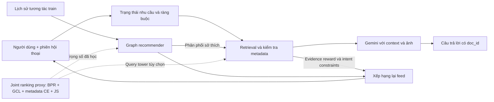

# Co-Guiding, hội thoại nhiều lượt và đánh giá câu trả lời

**Kết quả.** Inference coupling được đánh giá trên catalog connected với mô hình graph v2 có nguồn gốc sạch (`artifacts/evaluation/results_connected_coupling_v2`). RAG→feed giúp lấy lại mục tiêu mô phỏng trong top-10 từ 0 lên 16,67% ở nhánh có guard; Rec→RAG chưa cải thiện truy hồi. v2 được chạy sau khi xem lỗi test v1 nên là đánh giá khám phá. Chín run joint có giám sát bằng câu hỏi mô phỏng tổng quát hóa chưa tốt, nên query head mặc định tắt. Phương pháp và giới hạn: [CONVERSATIONAL_JOINT_METHOD.md](../CONVERSATIONAL_JOINT_METHOD.md).

**Giới hạn về mô hình.** Mô hình graph demo cũ phụ thuộc một thí nghiệm RecSys bị lỗi chia sẻ bộ nhớ đặc trưng trong BM3, nên các so sánh Co-Guiding theo mô hình đó không dùng làm kết luận; kết quả dựa trên mô hình có nguồn gốc sạch. Đánh giá grounding trên các context đã lưu và các thí nghiệm IR độc lập không bị ảnh hưởng. Chi tiết: `artifacts/evaluation/results_recsys/PROVENANCE_WARNING.md`.

Tài liệu mô tả phần đã chạy, giao thức, kết quả âm và giới hạn; chưa phải xác nhận hoàn thành toàn bộ đề cương.

## 1. Thành phần đã triển khai



### Hội thoại có trạng thái

`conversation_state.py` lưu tối đa 256 phiên trong RAM, TTL 30 phút, tối đa 8 lượt được giữ lại. Mỗi phiên có ID ngẫu nhiên và khóa riêng; profile offline được gắn cố định trong phiên. Lịch sử do server quản lý, không tin vào lịch sử tùy ý từ client. Reload không lưu hội thoại ra đĩa.

Trạng thái lưu hãng, dòng máy, dung lượng, RAM, dung lượng pin, phiên bản mạng và yêu cầu ảnh. Ví dụ “Samsung 128GB unlocked” → “còn 256GB thì sao” giữ hãng/mạng, thay dung lượng. “Máy đầu tiên” và “hai máy trên” tham chiếu các ID evidence của lượt trước. Đổi hãng xóa dòng máy cũ; “new search” hoặc nút Hội thoại mới xóa các điều kiện cũ.

Đây là rule-based dialogue state, chưa phải mô hình hội thoại học từ tập tương tác thật. Parser có phạm vi hạn chế; chưa xử lý mọi cách nói, mọi cấu hình CPU hoặc mọi loại phủ định.

### Ràng buộc và evidence

`catalog_facts` chỉ xác nhận trường có nguồn từ title hoặc metadata kỹ thuật. Review không chứng minh dung lượng, RAM hay phiên bản mạng. Điều kiện bắt buộc không có dữ kiện sẽ loại ứng viên, không suy đoán. Giá theo tiền tệ yêu cầu hiện chưa được xác thực; hỏi ngưỡng giá VND dẫn đến thông báo thiếu dữ kiện, không quy đổi giá Amazon ngầm.

Ảnh catalog được gửi cho Gemini khi generation bật, nhưng prompt không cho khẳng định tình trạng máy cũ, thời lượng pin hay chất lượng camera chỉ từ ảnh catalog. Nhận định cần viện dẫn `[doc_id]`. Lịch sử giúp hiểu câu hỏi; dữ kiện phải lấy từ context của lượt hiện tại. Đây là guard và instruction, không phải bảo đảm loại bỏ hoàn toàn hallucination.

### Phản hồi khi suy luận

`co_guiding.py` hỗ trợ 4 mode: `decoupled`, `rag_to_rec`, `rec_to_rag`, `coupled`.

- RAG → RecSys: dùng điều kiện hội thoại để loại sản phẩm thiếu/vi phạm điều kiện; thưởng cho sản phẩm có evidence trong câu trả lời, rồi xếp hạng lại feed.
- RecSys → RAG: dùng thứ hạng sở thích từ graph recommender để mở rộng tối đa 40 ứng viên và cộng preference RRF vào thứ hạng evidence.
- RRF cố định: $s_{RAG}(i)=1/(60+r_q(i))+0.2/(60+r_u(i))$; thành phần không có rank nhận 0. Candidate retrieval lấy 80 sản phẩm. Feed dùng tối đa 100 ứng viên từ RecSys cộng các evidence mới, loại item train đã thấy. Reward evidence là $0.03/r_e(i)$.

Đây là cơ chế hai chiều quan sát được lúc suy luận. Trọng số này cố định trước đánh giá, không được coi là reward đã học từ hành vi hoặc joint training của LLM.

## 2. Joint ranking được huấn luyện riêng

`joint_ranking.py` kết hợp typed graph GCL và query projection. Đầu vào thay thế của query là vector metadata sản phẩm ở **tương tác train**; không lấy metadata của target test làm query. Không sinh hội thoại giả rồi coi là lịch sử người dùng thật.

Ký hiệu $p_r=\operatorname{softmax}(q^Tz_i/\tau)$ là phân phối retrieval, $p_u=\operatorname{softmax}(z_u^Tz_i/\tau)$ là phân phối recommendation, $m=(p_r+p_u)/2$. Prototype huấn luyện:

$$\mathcal L_{joint}=\mathcal L_{BPR}+\lambda_{reg}\mathcal L_{reg}+\lambda_{GCL}\mathcal L_{GCL}+\lambda_{retr}\operatorname{CE}(p_r,i^+)+\lambda_{align}\operatorname{JS}(p_r,p_u).\tag{1}$$

$$\operatorname{JS}(p_r,p_u)=\tfrac12\operatorname{KL}(p_r\|m)+\tfrac12\operatorname{KL}(p_u\|m).\tag{2}$$

Gradient từ retrieval và JS đi vào graph representations và query projection; không detach một chiều để gọi đó là học tương hỗ. Gemini không được fine-tune. Giám sát hiện là catalog-alignment proxy; **chưa phải joint learning từ hội thoại–user–item thật**.

Đã chạy 3 cấu hình × 3 seed, 100 epoch; chọn checkpoint bằng validation, cùng split cũ:

| Cấu hình | λ retrieval | λ alignment | HR@10 mean | NDCG@10 mean |
|---|---:|---:|---:|---:|
| Joint control | 0 | 0 | 0,0230 | 0,0125 |
| Joint retrieval | 0,1 | 0 | 0,0402 | 0,0247 |
| Joint bidirectional | 0,1 | 0,02 | 0,0402 | 0,0247 |

JS chưa cải thiện hai chỉ số trên so với chỉ thêm retrieval loss. Với 5 người validation và 58 người test, chưa có kết luận thống kê hoặc kết luận hiệu quả hội thoại. Xem `artifacts/evaluation/results_joint_ranking/experiment.json` và `joint_ranking_report.md`.

Khi bật `--joint-ranking`, cả phân phối sở thích và query tower đã học được dùng trong Co-Guiding. Query tower thêm RRF có trọng số 0,5 vào evidence ranking. Không mặc định thay mô hình cũ chỉ vì đã viết thêm một objective.

## 3. Ablation Co-Guiding thực tế

Đánh giá trên 50 query đã có, dùng một profile offline cố định số 0. Các query không phải truy vấn thực do profile đó phát sinh. Mọi mode dùng cùng parser và fact constraints; khác biệt chỉ ở hướng phản hồi được bật.

| Mode | Precision@5 | NDCG@5 | MRR@5 |
|---|---:|---:|---:|
| Decoupled | 0,8400 | 0,8551 | 0,9333 |
| RAG → RecSys | 0,8400 | 0,8551 | 0,9333 |
| RecSys → RAG | 0,8240 | 0,8344 | 0,9067 |
| Hai chiều | 0,8240 | 0,8344 | 0,9067 |

RecSys thay đổi evidence ranking ở 37/50 query. RAG thay đổi feed ở 50/50 query. Các thay đổi này chứng minh kết nối hoạt động, **không chứng minh gợi ý tốt hơn**. Preference prior hiện làm giảm IR trên bộ query này.

Không báo cáo HR/NDCG cá nhân hóa cho Co-Guiding: chưa có các bộ ba user–query–item quan sát thật. Không dựng query từ sản phẩm test rồi báo HR cao. File `artifacts/evaluation/results_co_guiding/ablation.json` giữ trường này là null cùng lý do.

## 4. Chấm thử generation và nhãn kiểm tra

Đã sinh 6 câu trả lời bằng Gemini 2.5 Flash: 3 câu hỏi × 2 mode; có context và ảnh sản phẩm. Lượt chấm đầu có một JSON bị cắt và một lỗi dịch vụ 503. Giữ nguyên các lỗi trong `results_answers/`; không biến lỗi thành điểm hallucination bằng 0.

Sau đó chấm lại **cùng 6 câu trả lời**, bật JSON mode và giới hạn thinking budget 512, không sinh lại câu trả lời. Lưu ở `artifacts/evaluation/results_answers_rejudge/`.

- Tách 30 nhận định: 27 được judge xác nhận với quote khớp context, 3 chưa xác minh, 0 bị judge đánh dấu không được context hỗ trợ.
- Faithfulness trên phần đã judge được là 1,0; đây không phải xác nhận đúng toàn bộ 30 nhận định. Coverage trung bình theo câu lần lượt là 0,9167/0,9583.
- Context-unsupported rate trên phần judge được là 0; không diễn giải thành “hệ thống không có hallucination”.
- Answer relevance bằng cosine câu hỏi gốc và câu hỏi suy ngược từ câu trả lời: 0,7363 decoupled / 0,7065 coupled. Chỉ 3 câu mỗi mode.

Định nghĩa faithfulness tham khảo [Ragas Faithfulness](https://docs.ragas.io/en/stable/concepts/metrics/available_metrics/faithfulness/); reverse-question relevance tham khảo [Ragas Answer Relevancy](https://docs.ragas.io/en/stable/concepts/metrics/available_metrics/answer_relevance/). Đây là evaluator tự triển khai, không phải một lần chạy package Ragas chính thức. Generator và judge cùng nhà cung cấp, có self-judging bias; chưa hiệu chỉnh bằng người đánh giá.

File `manual_claim_labels.csv` có 30 dòng cần người đánh giá điền. Nhãn tự động nằm riêng ở `auto_supported`; cột `manual_supported` vẫn để trống. Không tự điền AI labels vào cột nhãn người.

## 5. Lệnh chạy

Từ `D:\DATN`:

```powershell
# Demo Co-Guiding + hội thoại nhiều lượt, model graph đã có
.\.venvs\rag\Scripts\python.exe -B rag\src\run.py chat_app --co-guiding --port 7860

# Dùng thêm joint-ranking prototype đã huấn luyện
.\.venvs\rag\Scripts\python.exe -B rag\src\run.py chat_app --co-guiding --joint-ranking --port 7860

# Functional scenarios: không gọi LLM
.\.venvs\rag\Scripts\python.exe -B rag\src\run.py evaluate_conversations

# Thí nghiệm mới: dùng thư mục mới, giữ lại kết quả trước
.\.venvs\rag\Scripts\python.exe -B rag\src\run.py evaluate_co_guiding --output rag\artifacts\evaluation\co_guiding_run2
.\.venvs\rag\Scripts\python.exe -B rag\src\run.py train_joint_ranking --models rag\artifacts\models\joint_run2 --output rag\artifacts\evaluation\joint_run2
.\.venvs\rag\Scripts\python.exe -B rag\src\run.py evaluate_answers --limit 3 --output rag\artifacts\evaluation\answers_run2
```

Trong UI, để trống profile thì dùng Pop cho cold start; nhập số profile offline để thử cá nhân hóa. Đây chưa phải đăng nhập người dùng thật. Khi đã bắt đầu phiên, dùng nút Hội thoại mới để đổi profile. API `/api/query` trả `session_id`, `recommendations`, `query_plan`, `feedback` và evidence. Client gửi lại `session_id` cho lượt tiếp theo.

Ví dụ request đầu: `{"query":"Samsung 128GB unlocked","user_index":0,"use_llm":false}`. Request tiếp: `{"query":"còn 256GB thì sao","session_id":"ID đã trả về","use_llm":false}`.

## 6. Giới hạn

Các ca chức năng hội thoại do người phát triển soạn để kiểm tra phần mềm, không phải khảo sát người dùng. Nhãn nhận định và relevance do người chấm vẫn cần được điền; nhãn tự động không thay thế bước này. Dữ liệu tương tác hiện có chưa đủ để chứng minh cải thiện cá nhân hóa hay học vòng phản hồi.
